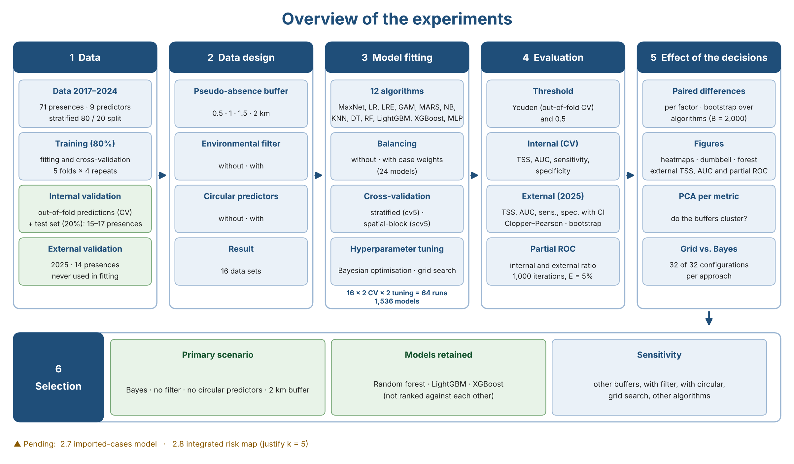
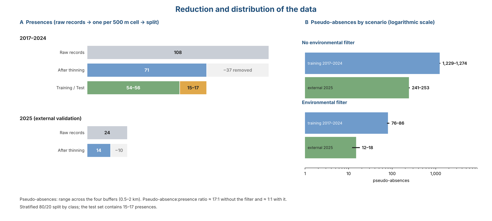

```{r}
#| label: setup-dir
#| include: false
# Folder that holds figuras_comparacion.R, qmd_bayes_v2/, qmd_grid_v2/, taylor_datos.RData,
# taylor_mapa.RData and the PNG schemes. Change it to your own path.
dir_qmd <- "~/Desktop/qmd_files"
```

# Part A. Extended Methods


## 2.1 Study area

The Mexico City Metropolitan Area (ZMCM) comprises 63 municipalities across Mexico City, the State of Mexico and Hidalgo, covering 608,852 hectares (ha), with approximately 21 million inhabitants. The climate is temperate with summer rainfall, a mean annual precipitation of 720 mm and temperatures ranging from −2 to 28 °C. Urban land use represents 33% of the surface of the ZMCM, based on Meta's Data for Good high-resolution global urban areas database (<https://dataforgood.facebook.com/dfg/tools/globalurbanareas>). The study area corresponds to the urban area of the ZMCM (Figure S1).


## 2.2 Predictors

All layers were harmonised to a common grid of about 500 m (EPSG:4326). Layers at finer resolution were aggregated with the mean (Google Earth Engine, `reduceResolution`). Layers at coarser resolution were resampled with bilinear interpolation (`terra::resample`). Nine predictors were used (Table S1):

: **Table S1.** Predictors used in the models (all harmonised to a ~500 m grid): description, source, native resolution and period.

| Variable | Description | Source | Native resolution | Period |
|---|---|---|---|---|
| `built` | Built-up area probability | Dynamic World (GEE) | 10 m | 2017–2019, 2021–2024 mean |
| `tree` | Tree cover probability | Dynamic World (GEE) | 10 m | same |
| `ndvi` | Vegetation index | Sentinel-2 (GEE) | 10 m | same |
| `prcp` | Annual precipitation (mm; mean of annual totals) | MexHiResClimDB | 20 arcsec (~560 m) | 2017–2020 |
| `ia` | Accessibility index | CONAPO | Locality | 2020 |
| `im` | Marginalisation index | CONAPO | Locality | 2020 |
| `ice` | Environmental quality index | CONAPO | Locality | 2020 |
| `pop` | Population count | LandScan Global | ~1 km | mean 2017–2019, 2021–2024 |
| `hfp` | Human footprint | Mu et al. (2022) | 1 km | mean 2017–2019, 2021–2022 |

Remote-sensing layers were obtained and pre-processed with the Google Earth Engine (GEE) Python API (`earthengine-api`, `geemap`), using the study-area polygon as region of interest. For each period (1 January 2017–31 December 2019, 1 January 2021–31 December 2024 and, for external validation, 1 January–31 December 2025) the temporal mean of each variable was computed. Built-up and tree-cover probabilities came from the Dynamic World V1 collection (`GOOGLE/DYNAMICWORLD/V1`, bands `built` and `trees`; 10 m). NDVI was computed per image as (B8 − B4)/(B8 + B4) from Sentinel-2 Level-2A harmonised surface reflectance (`COPERNICUS/S2_SR_HARMONIZED`, images with cloud cover < 20%; 10 m) and then averaged; for 2017, before the start of the Sentinel-2 Level-2A record (28 March 2017), it was complemented with Landsat 8 Collection 2 Level-2 images (cloud cover < 30%; bands SR_B5 and SR_B4; 30 m). Land-surface temperature (`temperature`) was obtained from MODIS MOD11A2 v061 (`LST_Day_1km`, 8-day composites at 1 km; scale factor 0.02, converted to °C). Minimum temperature (`tmin`), used only to define the environmental filter, was obtained from Daymet V4 (`NASA/ORNL/DAYMET_V4`, 1 km; temporal mean of the daily minimum temperature). Elevation was obtained with the R package `elevatr` (`get_elev_raster`, zoom level 10, about 150 m resolution at the latitude of the study area; default source: AWS Terrain Tiles) and resampled to the 500 m grid with bilinear interpolation (`terra::resample`). Each layer was aggregated to 500 m with the mean (`reduceResolution`), reprojected to EPSG:4326 and exported as a GeoTIFF through GEE export tasks to Google Drive, because direct downloads exceeded the memory limit of the service.

The locality-level indices (`ia`, `im`, `ice`) were interpolated to a continuous surface with SPDE–INLA, using the same procedure as for the CONEVAL social lag index. The human footprint was assumed continuous across years in the layers used. For the 2025 validation data, the layers were `prcp` of 2020 (latest available), `hfp` of 2022 (latest available) and LandScan Global 2026 (the edition used as the 2025 population estimate); `built`, `tree` and `ndvi` were composited for 2025. The Dynamic World habitat class (`dhi`) was evaluated and discarded.

### 2.2.1 Sociodemographic indices

Four sociodemographic indices for 2020 were available (Table S2): accessibility to urban centers (`ia`), marginalization (`im`) and environmental quality (`ice`), from CONAPO, and social lag (`irs`), from CONEVAL. The first three were used as predictors in both models (the *Ae. aegypti* model and the imported-cases model). The social lag index was **not** used as a predictor in any model. The four indices were used afterwards, once the models were fitted, only to describe the association between the final probabilities and the sociodemographic context: Spearman's correlations and medians by risk level (Part D). The main text reports accessibility and marginalization; the four indices are given in Part D.

: **Table S2.** Sociodemographic indices: variable, source and use in the analysis (all 2020).

| Variable | Index | Institution | Year | Source | Use |
|:--|:--|:--|:-:|:--|:--|
| `ia` | Accessibility to urban centers | CONAPO | 2020 | <https://www.gob.mx/conapo/documentos/analisis-geoespacial-de-la-accesibilidad-a-centros-urbanos-de-las-localidades-de-mexico> | Predictor (both models); association analysis |
| `im` | Marginalization | CONAPO | 2020 | <http://www.conapo.gob.mx/work/models/CONAPO/Marginacion> | Predictor (both models); association analysis |
| `ice` | Environmental Quality | CONAPO | 2020 | <https://www.gob.mx/conapo/documentos/indice-de-calidad-del-entorno?idiom=es> | Predictor (both models); association analysis |
| `irs` | Social Lag | CONEVAL | 2020 | <https://www.coneval.org.mx/Medicion/IRS/Paginas/Indice_Rezago_Social_2020.aspx> | Not a predictor; association analysis only |

*Note.* The four indices were interpolated to a continuous 100 m surface with SPDE–INLA and then aggregated, by the mean, to the ~500 m grid of the analysis. Interpretation: for `ia`, a higher value means greater accessibility; for `im`, greater marginalization; for `irs`, greater social lag (CONEVAL); for `ice`, a **lower** value means better environmental quality (inverted index).

## 2.3 Entomological data

### 2.3.1 Presences

*Aedes aegypti* occurrence data come exclusively from the ovitrap entomological surveillance network of the Integral Vector Monitoring System of the Mexico City health services. An ovitrap record was classified as a presence when eggs collected in the trap hatched and the emerged larvae were identified as *Ae. aegypti* at the fourth instar (L4), which allows reliable morphological identification of the species. Traps with no hatching, or with larvae not identified as *Ae. aegypti* L4, were not considered presences. A grid cell was assigned a presence when it contained at least one such record. No ovitrap data were collected in 2020 because of the COVID-19 epidemic. Records from 2017–2019 and 2021–2024 were used for training. Records from 2025 were used for external validation and never entered model fitting, hyperparameter tuning, or threshold selection. Presences were thinned to one record per 500 m cell (`thin_by_cell`): the 108 raw records of 2017–2024 were reduced to 71 and the 24 raw records of 2025 to 14.

```{r}
#| label: sfig-esquema
#| out-width: "100%"
#| fig-cap: "**Figure S2.** Overview of the experiments: data, data design, model fitting, evaluation, analysis of the effect of the analytical decisions and selection of the primary analysis and models."

```

### 2.3.2 Pseudo-absences and environmental filter

Pseudo-absences were sampled at random within the study area, excluding a buffer around presences (`tidysdm::sample_pseudoabs`, `dist_min`). Four buffer distances were evaluated as a sensitivity analysis (0.5, 1, 1.5 and 2 km). Two scenarios were compared:

- **Without environmental filter (primary analysis):** pseudo-absences drawn from the whole study area. The 2017–2024 dataset (before the 80/20 split) comprised 71 presences and 1,229–1,274 pseudo-absences depending on the buffer (about 17:1).
- **With environmental filter:** pseudo-absences restricted to environmentally unsuitable areas (minimum temperature < 10 °C and elevation > 2500 m; both conditions had to hold). The 2017–2024 dataset (before the 80/20 split) comprised 71 presences and 76–86 pseudo-absences depending on the buffer (about 1:1), the number being limited by the area available in unsuitable zones. In these datasets the climatic constraint, rather than the buffer, determined how close pseudo-absences lay to presences (minimum distance ≥ 1 km at all buffer sizes), so differences among buffers under the filter largely reflect sampling variability rather than the exclusion distance. The 2025 external set comprised 14 presences and 12–18 (with filter) or 241–253 (without filter) pseudo-absences, generated with the same procedure and buffer as the corresponding training set.

Temperature and elevation were used only to define the environmental filter and were excluded as predictors to avoid circularity: when included, the filter makes the classes separable by construction and inflates performance.

## 2.4 Epidemiological data

### 2.4.1 Presences

Dengue cases were obtained from the Vector-Borne Diseases module of the National Epidemiological Surveillance System (SINAVE). Autochthonous dengue transmission has not been demonstrated in Mexico City: the cases are residents who acquired the infection while travelling to endemic areas of Mexico and were diagnosed as laboratory-confirmed on their return, i.e., they are treated as confirmed imported cases. We identified 768 laboratory-confirmed imported cases in 2023–2024 (246 in 2023 and 522 in 2024) and 63 in 2025, all geocoded; 739 (236 in 2023 and 503 in 2024, used to fit the models) and 60 (2025, used for external validation) fell inside the study area. The spatial unit of the model is the residential address (point): the addresses were geocoded with the Google Geocoding API (<https://developers.google.com/maps/documentation/geocoding/get-api-key>) and, for each case, only the year and the resulting geographic coordinates were used, with no names or other personal identifiers. The case data are not distributed. Within the study area, cases were thinned to one per ~500 m cell with `tidysdm::thin_by_cell`: the 739 cases of 2023–2024 were reduced to 636 presences (632 in the final dataset) and the 60 cases of 2025 to 56 presences (54 in the final dataset).

### 2.4.2 Pseudo-absences and environmental filter

Pseudo-absences were drawn at random from the study area excluding a buffer around presences, and four buffers were evaluated (0.5, 1, 1.5 and 2 km). The 2023–2024 dataset comprised 632 presences and, without the environmental filter, 7,108, 4,695, 3,030 and 2,030 pseudo-absences (0.5, 1, 1.5 and 2 km; the 20 pseudo-absences per presence requested could not be reached because the buffers leave limited area) and, with the filter (minimum temperature < 10 °C and elevation > 2500 m), 454, 335, 233 and 176. The 2025 validation set comprised 54 presences and 974–993 pseudo-absences without the filter or 54–68 with it. As in the *Ae. aegypti* model, the primary scenario is without the filter and with the 2 km buffer.

## 2.5 Data partition and preprocessing

Models were fitted with `tidymodels`/`tidysdm`. The 2017–2024 dataset was split into training (80%) and test (20%) sets, stratified by class. Preprocessing recipes included k-nearest-neighbour imputation of predictors, centring and scaling of all numeric predictors, removal of near-zero-variance predictors, and removal of highly correlated predictors (|r| > 0.80). Class imbalance was handled in three ways: no balancing; upsampling of presences within the resamples (`themis::step_upsample`, over_ratio = 0.90, applied only to the analysis sets); and importance weights (weight 1 for pseudo-absences and n_absences/n_presences for presences, so that both classes contribute equally). Resampling used stratified V-fold cross-validation (`rsample::vfold_cv`) or spatial block cross-validation (`spatialsample::spatial_block_cv`), both with five folds and four repeats, on the training set. Results are reported for each combination. Figure S3 and Figure S4 show, for one example scenario, how the training set was divided into analysis and assessment sets in each of the 5 folds × 4 repeats.

Collinearity was checked in the training data of the scenario without circular predictors (nine predictors, as in the primary analysis). The highest absolute pairwise correlation was |r| = 0.70 (`prcp` and `ia`), followed by 0.60 (`tree` and `ndvi`) and 0.52 (`built` and `tree`); all other pairs were below 0.45. Because every correlation was below the lowest threshold we considered (0.75), the recipe retained all nine predictors at thresholds of 0.75, 0.80, 0.85, 0.90 and 0.95, so the fitted models do not depend on the threshold in this range and refitting was not necessary.

```{r}
#| label: setup-particiones
#| include: false
# Reproduce la partición 80/20 y los remuestreos de los qmd (escenario de ejemplo: sin filtro, buffer 1 km)
library(sf); library(dplyr); library(ggplot2); library(purrr)
load(file.path(dir_qmd, "qmd_bayes_v2/ae_aedes_2017_2024_layers_sfa_1k.RData")); data <- data_lyr; rm(data_lyr)
set.seed(12345)
split <- rsample::initial_split(data, prop = 0.8, strata = class)
train <- rsample::training(split)

set.seed(123456789)
cv_est <- rsample::vfold_cv(sf::st_drop_geometry(train), v = 5, repeats = 4, strata = class)
set.seed(123456789)
cv_esp <- spatialsample::spatial_block_cv(train, method = "random", v = 5, repeats = 4)

g_folds <- function(cv, train) {
  xy <- sf::st_coordinates(train)
  purrr::map_dfr(seq_len(nrow(cv)), function(i) {
    ana <- cv$splits[[i]]$in_id   # indices de analisis; la evaluacion es el complemento (out_id viene como NA)
    tibble::tibble(x = xy[, 1], y = xy[, 2], class = as.character(train$class),
                   rol = ifelse(seq_len(nrow(train)) %in% ana, "Training (analysis)", "Held-out (assessment)"),
                   rep = sub("Repeat", "Repeat ", cv$id[i]), fold = sub("Fold", "Fold ", cv$id2[i]))
  }) |>
    mutate(rol = factor(rol, c("Training (analysis)", "Held-out (assessment)"))) |>
    arrange(rol, class == "presence") |>
    ggplot(aes(x, y, colour = rol, size = class == "presence")) +
    geom_point(alpha = 0.8) +
    scale_colour_manual(values = c("grey70", "#D55E00"), name = NULL) +
    scale_size_manual(values = c(`FALSE` = 0.4, `TRUE` = 1.2), labels = c("pseudo-absence", "presence"), name = NULL) +
    facet_grid(rep ~ fold) + coord_equal() +
    theme_minimal(base_size = 9) +
    theme(axis.text = element_blank(), axis.title = element_blank(), panel.grid = element_blank(),
          legend.position = "bottom")
}
```

```{r}
#| label: sfig-folds-estrat
#| fig-width: 10
#| fig-height: 7.5
#| fig-cap: "**Figure S3.** Training set (80%) and its five folds × four repeats under stratified cross-validation. Orange: assessment observations of each resample; grey: analysis observations. Large points are presences. Example: no environmental filter, 1 km buffer."
g_folds(cv_est, train)
```

```{r}
#| label: sfig-folds-espacial
#| fig-width: 10
#| fig-height: 7.5
#| fig-cap: "**Figure S4.** As in the previous figure, for spatial block cross-validation (`spatial_block_cv`, random blocks): each fold assesses entire geographic blocks."
g_folds(cv_esp, train)
```


## 2.6 Algorithms and hyperparameter tuning

Twelve algorithms were fitted: MaxNet, logistic regression, elastic-net logistic regression, GAM (`mgcv`, `s(x, k = 3)`), MARS, naive Bayes, k-nearest neighbours, decision tree, random forest, LightGBM, XGBoost, and a single-layer neural network. Hyperparameters were tuned with the same recipes by grid search (`tune_grid`) and by Bayesian optimisation (`tune_bayes`; 15–35 initial points and 25–35 iterations depending on the algorithm, stopping after 10 iterations without improvement). Sensitivity was the first metric of the metric set and therefore the criterion optimised by Bayesian optimisation; for both approaches, the final configuration within each algorithm was selected by sensitivity (`select_best`), given the relevance of sensitivity in medical and public-health contexts, where failing to detect a positive site is costlier than a false alarm. Models were compared with TSS, AUC and partial ROC (partial AUC ratio). The 2025 data played no role in tuning. Both tuning approaches were run with each of the four exclusion buffers (0.5, 1, 1.5 and 2 km), as a sensitivity analysis to the buffer distance, for all combinations of cross-validation scheme, environmental filter and circular predictors.

### 2.6.1 Hyperparameters and search ranges

: **Table S3.** Algorithms, type of algorithm and hyperparameter search space of the Bayesian optimisation in the primary scenario of the *Ae. aegypti* model (no environmental filter, no circular predictors, 2 km buffer, spatial-block cross-validation).

| Algorithm | Type | Function (engine) | Tuned hyperparameter: search range |
|:--|:--|:--|:--|
| MaxNet | Classical | `tidysdm::maxent` (`maxnet`) | feature classes: l, lq, lqp, lqph, lqpht; regularization multiplier: 0.5–4 |
| Logistic regression | Classical | `logistic_reg` (`glm`) | none (not tuned; fitted on the resamples) |
| Generalized additive model (GAM) | Classical | `gen_additive_mod` (`mgcv`) | degrees-of-freedom adjustment: `dials` default range; fixed: `s(x, k = 3)`, no feature selection |
| Elastic-net logistic regression | Statistical learning | `logistic_reg` (`glmnet`) | penalty: 10^−3^–10^−1^ (log~10~ scale, −3 to −1); mixture: 0.1–0.9 |
| MARS | Statistical learning | `mars` (`earth`) | number of terms: 3–12; product degree: 1–2; pruning method: backward, forward |
| Naive Bayes | Machine learning | `naive_Bayes` (`naivebayes`) | smoothness: 0.5–2 |
| k-nearest neighbours | Machine learning | `nearest_neighbor` (`kknn`) | neighbours: `dials` default range; weight function: biweight, rectangular; distance power: `dials` default range |
| Decision tree | Machine learning | `decision_tree` (`rpart`) | minimum node size: 2–15; cost complexity and tree depth: `dials` default ranges |
| Random forest | Machine learning | `rand_forest` (`ranger`) | predictors per split (`mtry`): 2–9; trees: 100–1,000; minimum node size: 2–6 |
| LightGBM | Machine learning | `boost_tree` (`lightgbm`) | `mtry`: 2–9; trees: 100–1,000; tree depth: 3–10; loss reduction and learning rate: `dials` default ranges |
| XGBoost | Machine learning | `boost_tree` (`xgboost`) | `mtry`: 2–9; trees: 100–1,000; tree depth: 3–10; loss reduction and learning rate: `dials` default ranges |
| Neural network (MLP) | Machine learning | `mlp` (`nnet`) | hidden units: 1–8; penalty: 10^−4^–10^0^ (log~10~ scale, −4 to 0); epochs: 50–300 |

*Note.* Bayesian optimisation used 15 initial points and 25 iterations per algorithm, stopping after 10 iterations without improvement. Classes: *Classical* = established statistical or species-distribution models; *Statistical learning* = penalised or adaptive regression models; *Machine learning* = algorithms learned from data with flexible non-parametric structure. Ranges of MARS (number of terms), random forest, LightGBM and XGBoost (`mtry`, tree depth) were widened from 3–7, 2–6 and 3–6, respectively, when the selected value coincided with a limit of the original range. Ranges for the imported-cases model: see Section 2.8.1.

## 2.7 Performance evaluation

From out-of-fold predictions on the training data (internal validation), we computed sensitivity, specificity, TSS (sensitivity + specificity − 1) and AUC, and these are the metrics reported in the Results. The continuous Boyce index and PR-AUC were part of the metric set evaluated during tuning but are not used to compare scenarios. Partial ROC was computed separately from the tidymodels/tidysdm workflow with the `pROC` function of the `ntbox` package, for each of the 24 models (12 algorithms, with and without balancing). The continuous prediction of each model over the study area was evaluated against (i) the presences of the held-out test partition (internal) and (ii) the 14 presences of 2025 (external); in both evaluations the continuous prediction surface was generated with the 2017–2024 predictor layers, so the external partial ROC assesses the ranking of cells by the training-period surface against the 2025 presences and does not use the 2025 layers, using an omission threshold of E = 5%, 1,000 bootstrap iterations and 50% of the presences resampled per iteration. We report the mean partial AUC ratio and the proportion of iterations with a ratio ≤ 1. The partial ROC could not be computed for models whose prediction surface was degenerate, that is, with only a few distinct values and most of the study area at probability close to 1 (decision trees; under the environmental filter, KNN, MARS, GAM and logistic regression; and occasionally KNN and the MLP without the filter), because such surfaces provide no ranking of cells by suitability; these cases are reported as "not estimable" and the number of models affected is given for each scenario.

For external validation with the 2025 data (14 presences; 14 pseudo-absences in the filtered scenario and 250 in the unfiltered scenario), we report sensitivity, specificity, TSS and AUC at a classification threshold that maximises Youden's index in the cross-validation out-of-fold predictions of each model and scenario (the 2025 data were not used to choose it). Metrics at a fixed 0.5 threshold were also computed, but a fixed 0.5 threshold is a limitation when classes are unbalanced, so the Results report the Youden threshold; for models that could not be cross-validated (GAM with the environmental filter) only the 0.5 threshold is available. Given the small number of presences, 95% confidence intervals were computed as exact Clopper–Pearson intervals for sensitivity and specificity and as percentile intervals from a stratified cell-cluster bootstrap (B = 2,000) for TSS and AUC, using the same bootstrap samples for all models.

The metrics used to evaluate the models, with their formulas, range, assumptions and interpretation, are summarised in Table S4.

: **Table S4.** Evaluation metrics: formula, range of values, assumptions and interpretation.

| Metric | Formula | Range | Assumptions and caveats | Interpretation |
|:--|:--|:--|:--|:--|
| Sensitivity (true-positive rate) | $TP / (TP + FN)$ | 0 to 1 | Threshold-dependent. Presences are treated as certain. | Proportion of presences predicted as presence (1 − omission rate). 1 = no presence missed. |
| Specificity (true-negative rate) | $TN / (TN + FP)$ | 0 to 1 | Threshold-dependent. Pseudo-absences are treated as absences, although they are background points that may lie in suitable but unsampled sites. | Proportion of pseudo-absences predicted as absence. With pseudo-absences it is a relative measure, not a true absence rate. |
| True skill statistic (TSS) | $\text{Sensitivity} + \text{Specificity} - 1$ | −1 to 1 | Threshold-dependent. In principle independent of prevalence, but it depends on how pseudo-absences were drawn (number, buffer, environmental filter). | 0 = no better than random; 1 = perfect discrimination; negative values = worse than random. |
| Youden's index and threshold | $J = \max_t \left[\text{Sens}(t) + \text{Spec}(t) - 1\right]$; the threshold $t^{*}$ is the value of $t$ that attains the maximum | 0 to 1 (threshold: 0 to 1) | Equals the TSS at $t^{*}$. Here $t^{*}$ was derived from the cross-validation out-of-fold predictions and then applied to the independent 2025 data. | Classification threshold that balances sensitivity and specificity; it avoids a fixed 0.5 cut-off when classes are unbalanced. |
| Area under the ROC curve (AUC) | $\int_0^1 \text{Sens}\; d(1-\text{Spec})$, equal to $P(\hat{p}_{\text{presence}} > \hat{p}_{\text{pseudo-absence}})$ | 0 to 1 (0.5 = random) | Threshold-independent. Depends on the pseudo-absences (it cannot reach 1 if pseudo-absences lie in suitable sites). | Probability that a random presence receives a higher score than a random pseudo-absence. 0.5 = random; 1 = perfect separation. |
| Partial ROC (AUC ratio, E = 5%) | $\text{pAUC}_{\text{model}} / \text{pAUC}_{\text{random}}$, with the area restricted to omission error $\le E = 5\%$ | 0 to 2 (1 = random) | Presence-only measure: needs no absences. Bootstrap over presences (1,000 iterations, 50% resampled); not estimable when the prediction surface is degenerate. | Ranking of cells by the model, controlling omission. Ratio > 1 = better than random; the proportion of iterations with a ratio ≤ 1 acts as a p-value. |
| Continuous Boyce index | Spearman correlation between the predicted-to-expected frequency ratio, $P/E$, and the habitat suitability, across suitability classes | −1 to 1 | Presence-only. Computed during tuning, not used to compare scenarios. | > 0 = presences fall in cells of higher suitability than expected; 0 = random; < 0 = the model is worse than random. |
| Area under the precision–recall curve (PR-AUC) | $\int \text{Precision}\; d(\text{Recall})$, with $\text{Precision} = TP / (TP + FP)$ and $\text{Recall} = \text{Sensitivity}$ | 0 to 1 (baseline = proportion of presences) | Sensitive to class imbalance; the baseline depends on the arbitrary ratio of pseudo-absences to presences. Computed during tuning, not used to compare scenarios. | Higher = better precision at a given recall; to be read against the proportion of presences. |

*Note.* TP, true positives (presences predicted as presence at the threshold); FN, false negatives; TN, true negatives (pseudo-absences predicted as absence); FP, false positives; $\hat{p}$, predicted probability.

### 2.7.1 Selection of the primary analysis and models

Because the analysis crosses many analytical decisions, we defined the primary analysis by methodological criteria rather than by the highest external metric. The primary scenario was Bayesian optimisation without the environmental filter and without circular predictors, with a 2 km pseudo-absence buffer. We did not use the environmental filter as primary because it restricts pseudo-absences to climatically unsuitable areas by construction, which makes the classes easy to separate (cross-validated TSS 0.92–0.97 with the filter versus about 0.58 without it), leaves only 12–18 pseudo-absences in the 2025 set, and inflates TSS without improving the ranking of cells (partial-ROC ratio about 1.4 with the filter versus 1.8 without it). We excluded the circular predictors (temperature and elevation) because they are also the variables that define the filter and are closely tied to where presences occur, and because they changed the classification threshold and TSS but hardly the AUC or the partial-ROC ratio. We used the 2 km buffer because it applies the largest exclusion distance around presences, which lowers the risk that pseudo-absences fall on unrecorded suitable sites, and because performance did not differ consistently among buffers; external TSS and AUC were slightly higher at 2 km, but this was not the basis of the choice. The other buffers, the scenarios with the filter and with circular predictors, and grid search are reported as sensitivity analyses. We chose Bayesian optimisation as the primary tuning approach because it was defined beforehand and requires far fewer model fits than grid search, and because the choice of approach did not change the results: for the *Ae. aegypti* model, the models obtained with Bayesian optimisation and with grid search were similar in all 32 configurations (median paired difference of 0.000 in external TSS, external AUC and cross-validated TSS and AUC; B.3.1), and the effects of the analytical decisions and the performance of the three retained algorithms were the same under both.

Within this scenario we retained the three algorithms that performed best and most consistently: random forest, LightGBM and XGBoost. The criteria were high external discrimination (AUC and TSS), a cross-validated TSS close to the external TSS (no sign of overestimation by cross-validation), a partial-ROC ratio above 1 in every estimable combination with the highest ratios among the algorithms, and a result that could be estimated in every scenario. Given that the external set has 14 presences, we do not rank the three algorithms against each other; they are treated as comparable candidates and, if used jointly, as members of an ensemble.

### 2.7.2 Multi-criteria ranking of the algorithms (TOPSIS)

To integrate the criteria used for model selection into a single ranking, we applied TOPSIS (Technique for Order of Preference by Similarity to Ideal Solution) to the algorithms in the primary scenario (Bayesian optimisation, no environmental filter, no circular predictors, 2 km buffer). The value of each algorithm for each criterion was the median across the two cross-validation types and the two weighting options. The criteria were external TSS, external AUC and the external partial-ROC ratio (benefit criteria), the absolute difference between cross-validated and external TSS (cost criterion) and the proportion of scenarios in which the partial ROC could be estimated (benefit criterion). Each criterion was normalised by its vector norm and given the same weight, and the closeness to the ideal solution was computed as C = D⁻ / (D⁺ + D⁻), where D⁺ and D⁻ are the Euclidean distances to the best and worst values of every criterion. To assess the dependence of the ranking on the weights, we repeated the calculation with 5,000 weight vectors drawn from a uniform Dirichlet distribution and report the probability that each algorithm ranks first and among the first three. Algorithms for which a criterion could not be computed were excluded. Because the external set has 14 presences, the ranking is descriptive and was not used to rank the retained algorithms against each other.

### 2.7.3 Effect of the analytical decisions and PCA

The study is a full factorial benchmark: 2 cross-validation schemes × 2 environmental-filter options × 4 buffers × 2 circular-predictor options = 32 configurations for each tuning approach (64 runs and 1,536 models, with 12 algorithms with and without case weights). Because every algorithm is fitted under every configuration, the algorithms act as repeated units, and the effect of each factor was estimated as the median of paired differences (same algorithm, same case-weight option and same remaining factors) with a 95% percentile interval from a bootstrap over algorithms (B = 2,000). Effects are reported for external TSS, external AUC, cross-validated TSS and the external partial-ROC ratio, and for the tuning approach (grid minus Bayesian optimisation). They are descriptive estimates of how much each decision shifts performance, not hypothesis tests, because the models are not independent samples.

To explore whether the configurations rank the algorithms similarly, we ran a principal component analysis (PCA) separately for each external metric (TSS, AUC, partial-ROC ratio) on the matrix of models (rows: algorithm × cross-validation type) by configurations (columns: filter × circularity × buffer), with pairwise-complete correlations and standardised columns; configurations with fewer than five finite values were dropped. In the correlation circle each arrow is a configuration, its length shows how well it is represented on the first two components and the angle between arrows shows the similarity of the model ranking. Because the columns are standardised, the PCA shows the consistency of the ranking and not the size of the effects.

### 2.7.4 Taylor diagrams

We summarised the agreement of the predicted probabilities with two references using Taylor diagrams, which place each algorithm by its correlation with the reference (angle), the standard deviation normalised by that of the reference (radius) and the centred root-mean-square difference (distance to the reference point). In the first, the reference was the observed class of the 2025 external set (1 = presence, 0 = pseudo-absence), using the predictions of the primary scenario with stratified cross-validation and without case weights; because the reference is binary, the correlation is point-biserial and the diagram is a descriptive complement to the external metrics. In the second, the reference was the consensus of the retained algorithms (random forest, LightGBM and XGBoost), using the predictions of every algorithm over a random sample of cells of the study area (`tidysdm::predict_raster`); to avoid circularity each retained algorithm was compared with the mean of the other two, and the remaining algorithms with the mean of the three. This second diagram measures cell-by-cell agreement among prediction maps, not accuracy, and favours tree-based models because the consensus is built from them.

## 2.8 Imported-cases / dengue transmission model

The imported-cases model uses the same nine predictors (Section 2.2) and the same ~500 m grid as the *Ae. aegypti* model, and the data described in Section 2.4. Cases from 2023 and 2024 were used for fitting and tuning, and cases from 2025 for external validation. The analysis mirrors that of the *Ae. aegypti* model: the primary scenario is Bayesian optimisation, no circular predictors, a 2 km buffer and spatial-block cross-validation, with the same twelve algorithms (Section 2.6), the same recipes and class-balancing options (Section 2.5) and the same evaluation scheme (Section 2.7). As in that model, precipitation (MexHiResClimDB, available only up to 2020) corresponds to the 2017–2020 layer (2020 for the 2025 validation data) and therefore does not match the years of the cases.

### 2.8.1 Hyperparameter search ranges

Bayesian optimisation used 15 initial points and 25 iterations, as in the *Ae. aegypti* model. Grid search was not run for the imported-cases model; the comparison between grid search and Bayesian optimisation was carried out only for the *Ae. aegypti* model (Section B.3.1). The search ranges were those of Table S3, except for the following algorithms: MARS (number of terms: 3–12), random forest (minimum node size: 2–20; `mtry`: 2–6), LightGBM (`mtry`: 2–9; tree depth: 1–8) and XGBoost (`mtry`: 2–6; trees: 20–1,000; tree depth: 1–6; learning rate: 10^−3^–10^0^, log~10~ scale). The ranges of the number of terms of MARS and of the learning rate of XGBoost were widened after the selected values coincided with a limit of the original range.

### 2.8.2 Selection of the algorithms and consensus

In the primary scenario, the spatial cross-validated discrimination of the three retained algorithms was high (TSS 0.71–0.73, AUC 0.93–0.94) and no algorithm was clearly superior; LightGBM, XGBoost and random forest were among those with the highest AUC. The epidemiological probability surface was obtained as the mean of the probabilities of the same three algorithms retained for the *Ae. aegypti* model (random forest, LightGBM and XGBoost). Because no algorithm was clearly superior for imported cases (the multicriteria summaries, TOPSIS and Taylor diagrams, are presented in Part C), the consensus avoids relying on a single algorithm. For the consensus, the classification threshold was the mean of the three cross-validated Youden thresholds.

### 2.8.3 Partial ROC and external validation

The partial ROC (E = 5%; 1,000 iterations resampling 50% of the presences) exceeded random expectation in all cases (p < 0.001): the mean ratio was 1.21–1.22 (random forest, LightGBM and XGBoost) with the 2023–2024 test presences and 1.14–1.18 with the 2025 presences; the intervals of the three algorithms overlap in the external validation.

External validation with the 2025 cases required a design check. Because the 2025 pseudo-absences were drawn excluding only a 2 km buffer around the 54 presences of 2025, 72% of them lay within 2 km of a 2023–2024 presence, a distance that is excluded by construction in the training data; the task thus became discriminating within the urban area, and performance was lower (three retained algorithms: TSS 0.32–0.37, AUC 0.74–0.75, with overlapping confidence intervals among algorithms). When the external pseudo-absences were restricted to those at least 2 km from any 2023–2024 presence (the rule applied in training; 271 of 974 retained), external performance was TSS 0.79–0.86 and AUC 0.95–0.97 for the three retained algorithms (consensus of the three algorithms: TSS 0.85, AUC 0.98; with all pseudo-absences, TSS 0.35 and AUC 0.76). Both validations are reported in Part C; the second is a sensitivity analysis of the validation design and was not used to select the model.

## 2.9 Integrated risk map

The predicted probabilities from the epidemiological (dengue) and entomological (vector) models were used as inputs to a cluster analysis (k-means on the standardised probabilities) that classified the study area into five ordinal epidemiological risk scenarios: very low, low, moderate, high and very high. Clusters were ordered by the mean of the two probabilities (of transmission and of *Ae. aegypti* presence) of their cells, and assigned in that order to the risk levels (Figure 5D of the main text). In addition, a bivariate map of both probabilities was produced by classifying each into quintiles (5 × 5 grid) with the `biscale` package, and the Pearson correlation between them was computed.

The number of clusters was fixed a priori at k = 5 to obtain five ordinal risk levels that can be communicated and used operationally, and was not chosen by optimising a fit criterion. This is consistent with public health risk assessment manuals, which rate likelihood and consequences on five-category ordinal scales and classify risk into ordered categories from low to very high (World Health Organization, 2012; Secretaría de Salud, 2025). Because the probability of vector presence is highly skewed, the clusters should be read as relative risk scenarios and not as absolute thresholds.

To estimate the population in each risk level, the population of each locality in the 2020 Population and Housing Census (INEGI, ITER by locality) was distributed among the ~500 m cells within its polygon, weighted by the population layer used as a predictor (localities without a polygon were assigned by their coordinates), so that the total of each locality matches the Census.

**References**

- World Health Organization. Rapid Risk Assessment of Acute Public Health Events. WHO/HSE/GAR/ARO/2012.1. Geneva: WHO; 2012.
- Secretaría de Salud, Dirección General de Epidemiología. Manual de procedimientos de operación estandarizado de evaluación de riesgos para eventos agudos en salud pública. Ciudad de México: Secretaría de Salud; marzo de 2025.

## 2.10 Reproducibility

### 2.10.1 Software

Analyses were run in R 4.5.3 (Linux, x86_64) and R 4.6.0 (macOS, aarch64), using the same code on both machines. Random seeds were fixed. Google Earth Engine layers were obtained with Python 3.14 (`earthengine-api` 1.7.25, `geemap` 0.37.3, `geopandas` 1.1.3).

### 2.10.2 Packages

Models were fitted with `tidymodels` 1.4.1 (`tune` 2.0.1, `parsnip` 1.4.1, `recipes` 1.3.2, `rsample` 1.3.2, `workflows` 1.3.0, `yardstick` 1.3.2, `dials` 1.4.2), `tidysdm` 1.0.4, `spatialsample` 0.6.1 and `themis` 1.0.3. Algorithm engines were `maxnet` 0.1.4, `glmnet` 4.1-10, `mgcv` 1.9-4, `earth` 5.3.6, `naivebayes` 1.0.0, `kknn` 1.4.1, `rpart` 4.1.24, `ranger` 0.18.0, `lightgbm` 4.6.0, `xgboost` 3.2.1.1 and `nnet` 7.3-20. Spatial data were handled with `terra` 1.9-11, `sf` 1.1-0 and `elevatr` 0.99.1; partial ROC with `ntbox` 0.7.2; the SPDE–INLA interpolation with `INLA` 26.6.8.

### 2.10.3 Repository

The *Ae. aegypti* ovitrap database for the ZMCM (2017–2024, with its training and test partitions, and the 2025 external validation data), the study-area polygon, the three consensus rasters (probability of *Ae. aegypti* presence, probability of confirmed imported dengue cases and epidemiological risk) and the code of the machine-learning workflow (Quarto vignettes) are available in the R package `dengueriskcdmx` (Zenodo, <https://github.com/fdzul/dengueriskcdmx>, <https://fdzul.github.io/dengueriskcdmx/>). The data on confirmed dengue cases are not distributed. An interactive dashboard (<https://eclectic-alfajores-088839.netlify.app/#escenarios-epidemiológicos>) displays the probability maps and the dengue risk map.

# Part B. Results of the *Ae. aegypti* model (preliminary: four buffers; Bayesian optimisation and grid search)

> Draft for the progress report. Grid search has been completed (32 configurations) and is compared with Bayesian optimisation in B.3.1; the main figures and tables use Bayesian optimisation. The four buffers were rerun with Bayesian optimisation; the earlier 1.5 km results were discarded because of an error in the generation of that dataset (the 1 km buffer was applied). Numbers below are medians over the stated scenarios; "external" refers to the 2025 data (14 presences). Figures were generated with `figuras_comparacion.R`.

```{r}
#| label: setup-resultados
#| include: false
# Bayes only, four buffers. Paths are relative to dir_qmd (defined in the first chunk).
knitr::opts_chunk$set(echo = FALSE, warning = FALSE, message = FALSE, dpi = 300)
source(file.path(dir_qmd, "figuras_comparacion.R"))
buffers <- c("0.5 km", "1 km", "1.5 km", "2 km"); tuning_ <- "Bayesian opt."
# Cada archivo en su propio entorno (ambos pueden llamarse resultados_long.RData / objeto resultados_long)
e1 <- new.env(); load(file.path(dir_qmd, "qmd_bayes_v2/metricas/resultados_long.RData"), envir = e1)
e2 <- new.env(); load(file.path(dir_qmd, "qmd_bayes_v2/pROC/resultados_long.RData"), envir = e2)
resultados_long <- get(ls(e1)[1], envir = e1)   # métricas (tiene `partition`)
res_all         <- get(ls(e2)[1], envir = e2)   # partial ROC
res  <- resultados_a_ancho(resultados_long) |>
  dplyr::filter(buffer %in% buffers) |> dplyr::mutate(buffer = droplevels(buffer))
proc <- proc_a_ancho(res_all) |>
  dplyr::filter(buffer %in% buffers) |> dplyr::mutate(buffer = droplevels(buffer))
# Grid search (for the tuning comparison only; the main figures use Bayes)
e3 <- new.env(); load(file.path(dir_qmd, "qmd_grid_v2/metricas/resultados_long.RData"), envir = e3)
e4 <- new.env(); load(file.path(dir_qmd, "qmd_grid_v2/pROC/resultados_long.RData"), envir = e4)
res_t  <- dplyr::bind_rows(resultados_long, get(ls(e3)[1], envir = e3)) |> resultados_a_ancho() |>
  dplyr::filter(buffer %in% buffers) |> dplyr::mutate(buffer = droplevels(buffer))
proc_t <- dplyr::bind_rows(res_all, get(ls(e4)[1], envir = e4)) |> proc_a_ancho() |>
  dplyr::filter(buffer %in% buffers) |> dplyr::mutate(buffer = droplevels(buffer))
```

## B.1 Data sets

The 2017–2024 data set contained 71 presences in every scenario. With the environmental filter it contained 76–86 pseudo-absences (about 1:1) and without the filter 1,229–1,274 (about 17:1), depending on the buffer; the stratified 80/20 split left 15–17 presences in the test set. The 2025 external set contained 14 presences and 12–18 (with filter) or 241–253 (without filter) pseudo-absences. Under the environmental filter the minimum distance between pseudo-absences and presences was ≥ 1 km at every buffer size (5.7–10.8 km in the 2025 set), so the climatic constraint, not the buffer, determined how close pseudo-absences lay to presences.

```{r}
#| label: sfig-reduccion
#| out-width: "100%"
#| fig-cap: "**Figure S5.** Reduction and distribution of the data. (A) Presences: raw records, records kept after thinning to one per 500 m cell, and training/test split. (B) Pseudo-absences in the training (2017–2024) and external (2025) sets, with and without the environmental filter (range across the four buffers)."

```

## B.2 Performance by algorithm

Results in this section summarise the scenarios that are directly comparable across algorithms (without environmental filter, and with filter but without circular predictors).

Two summaries are given because they answer different questions: the table below pools the comparable scenarios of all four buffers (an overview of algorithm behaviour), whereas the second table restricts to the primary scenario (no environmental filter, no circular predictors, 2 km buffer; see 2.7.1), which is the one used to retain models. Figures therefore differ between them (for example, random forest external TSS 0.67 pooled versus 0.74 in the primary scenario).

Tree ensembles performed best (external TSS / AUC / partial-ROC ratio; medians over the comparable scenarios): random forest 0.67 / 0.94 / 1.83, LightGBM 0.67 / 0.93 / 1.78 and XGBoost 0.65 / 0.92 / 1.71. Their cross-validated TSS was close to the external TSS (difference −0.01 to +0.02), i.e. cross-validation did not overestimate external performance, and the external TSS confidence interval included zero in 0 of 48 scenarios for random forest, 1 for LightGBM and 3 for XGBoost. Differences among these three algorithms are small relative to the uncertainty of an external set with 14 presences and should not be interpreted as a ranking. k-nearest neighbours reached the highest external TSS (0.75) but its cross-validated TSS was much lower (0.56), and its partial ROC could be estimated in only 26 of 48 comparable combinations (see B.4); we therefore do not rank it first.

Logistic regression, elastic-net logistic regression, the neural network and MaxNet detected all or nearly all external presences (median sensitivity 1.00) at the cost of low specificity (0.33–0.50), i.e. they over-predicted presence; their external TSS was 0.33–0.43. MARS (0.58), naive Bayes (0.53; sensitivity 0.75, specificity 0.80) and GAM (0.46) were intermediate. MaxNet and the regularised logistic models had a cross-validated TSS 0.16–0.24 higher than the external TSS, and the decision tree discriminated poorly (external AUC 0.70).

The partial-ROC ratio (E = 5%, 1,000 bootstrap iterations, 50% resampling) could be estimated for 625 of the 768 model–scenario combinations with the 2025 presences and 631 of 768 with the internal test presences (81–82%; see Methods for the cases that could not be estimated). Among the estimable combinations the median ratio was similar with the 2025 presences (1.50) and with the internal test presences (1.51), so partial ROC gave no evidence of lower performance in the external set. With the environmental filter the medians were 1.38 (external) and 1.38 (internal); without the filter, 1.56 and 1.62. The proportion of iterations with a ratio ≤ 1 was zero in every estimable combination (minimum mean ratio 1.03 external, 1.07 internal). The ratio hardly varied among buffers (medians 1.35–1.41 with the filter and 1.55–1.57 without it). By algorithm (median across scenarios, external): k-nearest neighbours 1.78 (estimable in few scenarios), random forest 1.70, LightGBM 1.60, XGBoost 1.58, GAM 1.51, MaxNet 1.51, MARS 1.50, elastic-net logistic regression 1.48, logistic regression 1.48, MLP 1.47 and naive Bayes 1.45; decision trees were lowest (1.17) and estimable in few scenarios.

```{r}
#| label: sfig-tss-externo
#| fig-width: 11
#| fig-height: 6
#| fig-cap: "**Figure S6.** External TSS (2025) by algorithm, scenario and buffer (Bayesian optimisation). Grey: not estimable. *: 95% CI includes 0."
g_heatmap(res, "tss_ext", tuning_)
```

```{r}
#| label: sfig-auc-externo
#| fig-width: 11
#| fig-height: 6
#| fig-cap: "**Figure S7.** External AUC (2025). Grey: not estimable. *: 95% CI includes 0.5."
g_heatmap(res, "auc_ext", tuning_)
```

```{r}
#| label: sfig-proc-externo
#| fig-width: 11
#| fig-height: 6
#| fig-cap: "**Figure S8.** Partial-ROC ratio (E = 5%) with the 2025 presences. 1 = no better than random. Grey: not estimable."
g_heatmap_proc(proc, "ratio_external", tuning_)
```

```{r}
#| label: tabla-ranking
ranking <- res |>
  dplyr::filter(filtro == "No env. filter" | circ == "Without circularity") |>
  dplyr::group_by(algoritmo) |>
  dplyr::summarise(`TSS ext` = median(tss_ext, na.rm = TRUE), `AUC ext` = median(auc_ext, na.rm = TRUE),
                   `Sens ext` = median(sens_ext, na.rm = TRUE), `Spec ext` = median(spec_ext, na.rm = TRUE),
                   `TSS CV` = median(tss_cv, na.rm = TRUE), .groups = "drop") |>
  dplyr::mutate(`Gap (CV - ext)` = `TSS CV` - `TSS ext`) |>
  dplyr::left_join(proc |>
      dplyr::filter(filtro == "No env. filter" | circ == "Without circularity") |>
      dplyr::group_by(algoritmo) |>
      dplyr::summarise(`pROC ext` = median(ratio_external, na.rm = TRUE), .groups = "drop"), by = "algoritmo") |>
  dplyr::arrange(dplyr::desc(`TSS ext`))
knitr::kable(ranking, digits = 2, caption = "Table S5. Medians over without-filter scenarios and with-filter scenarios without circular predictors.")
```

```{r}
#| label: tabla-ranking-primario
ranking_prim <- res |>
  dplyr::filter(filtro == "No env. filter", circ == "Without circularity", buffer == "2 km") |>
  dplyr::group_by(algoritmo) |>
  dplyr::summarise(`TSS ext` = median(tss_ext, na.rm = TRUE), `AUC ext` = median(auc_ext, na.rm = TRUE),
                   `Sens ext` = median(sens_ext, na.rm = TRUE), `Spec ext` = median(spec_ext, na.rm = TRUE),
                   `TSS CV` = median(tss_cv, na.rm = TRUE), .groups = "drop") |>
  dplyr::mutate(`Gap (CV - ext)` = `TSS CV` - `TSS ext`) |>
  dplyr::left_join(proc |>
      dplyr::filter(filtro == "No env. filter", circ == "Without circularity", buffer == "2 km") |>
      dplyr::group_by(algoritmo) |>
      dplyr::summarise(`pROC ext` = median(ratio_external, na.rm = TRUE), .groups = "drop"), by = "algoritmo") |>
  dplyr::arrange(dplyr::desc(`TSS ext`))
knitr::kable(ranking_prim, digits = 2, caption = "Table S6. Primary scenario (no environmental filter, no circular predictors, 2 km buffer): medians over CV type and with/without case weights.")
```

### B.2.1 Multi-criteria ranking (TOPSIS)

In the primary scenario, TOPSIS with equal weights ranked XGBoost first (closeness to the ideal solution 0.88), followed by LightGBM (0.77), MARS (0.67), random forest (0.66), GAM (0.61) and k-nearest neighbours (0.52); MaxNet and the logistic models, naive Bayes and the neural network were last (0.26–0.43). The decision tree was excluded because its partial ROC could not be estimated in the primary scenario (it was estimable in 16% of combinations). The three tree ensembles were therefore among the first four. MARS reached third place because of the small difference between its cross-validated and external TSS and not because of its discrimination (external TSS 0.58, AUC 0.83), and it differed from random forest by 0.01. With random weights, the probability of ranking among the first three was 0.90 for XGBoost, 0.78 for LightGBM and 0.59 for random forest, against 0.35 for MARS; XGBoost and LightGBM ranked first in 64% and 35% of the draws. k-nearest neighbours fell to sixth place because its partial ROC could be estimated in only 42% of combinations and its cross-validated TSS was 0.26 below its external TSS. The ranking supports the choice of the tree ensembles, but the differences among the first four are small relative to the uncertainty of the external set.

```{r}
#| label: sfig-topsis
#| fig-width: 8
#| fig-height: 4.5
#| fig-cap: "**Figure S9.** Multi-criteria ranking (TOPSIS, equal weights) of the algorithms in the primary scenario. Bars sorted by performance score (closeness to the ideal solution, 0–1); one colour per algorithm."
tp <- topsis_modelos(pca_datos(res, proc), tuning_sel = tuning_)
g_topsis(tp)
```

```{r}
#| label: tabla-topsis
knitr::kable(dplyr::transmute(tp$tabla, Algorithm = algoritmo, `External TSS` = tss_ext, `External AUC` = auc_ext,
                              `External pROC` = ratio_external, `|TSS CV - TSS ext|` = gap_abs, `Estimable pROC` = estimable,
                              C = C, Rank = rango, `P(top 3)` = p_top3, `P(first)` = p_rango1), digits = 2,
             caption = "Table S7. TOPSIS in the primary scenario: criteria (medians), closeness to the ideal solution (C) and rank with equal weights, and probability of ranking among the first three and first with random weights.")
```

```{r}
#| label: sfig-taylor
#| fig-width: 7
#| fig-height: 6.5
#| fig-cap: "**Figure S10.** Taylor diagram of the algorithms in the 2025 external validation (primary scenario, Bayesian optimisation, stratified cross-validation, without case weights). Angle: correlation between predicted probability and observed class (0/1); radius: standard deviation of the prediction normalised by the observed one; dashed lines: centred RMS difference; black diamond: reference (observation). Closer to the diamond = better."
load(file.path(dir_qmd, "taylor_datos.RData"))
st <- pred_ext |> dplyr::filter(cv == "cv5", !stringr::str_detect(modelo, "wdb"), !is.na(pred)) |> taylor_stats()
g_taylor(st)
```

In the Taylor diagram against the observed 2025 class (Figure S10), no algorithm approached the reference point: the highest correlation between predicted probability and observed class was about 0.55 (KNN), as expected with a binary reference and 14 presences. Random Forest, XGBoost, LightGBM, KNN and Decision Tree had the highest correlations (about 0.4–0.55), and MaxNet, Naive Bayes and MLP were close to uncorrelated (r below about 0.2). MaxNet, GAM and Logistic Regression were over-dispersed relative to the observation without a corresponding correlation, whereas Random Forest, MARS, Naive Bayes and MLP were under-dispersed. The ordering was broadly consistent with TOPSIS, but differences among the best algorithms are within what 14 presences can resolve.

```{r}
#| label: sfig-taylor-consenso
#| fig-width: 7
#| fig-height: 6.5
#| fig-cap: "**Figure S11.** Taylor diagram with a continuous reference: consensus of the retained models (mean of Random Forest, LightGBM and XGBoost) over a random sample of study-area cells. For each retained algorithm the reference is the mean of the other two (to avoid circularity); for the others, the mean of the three. It measures cell-by-cell agreement among maps, not accuracy against observations."
load(file.path(dir_qmd, "taylor_mapa.RData"))
st2 <- pred_mapa |> dplyr::filter(!is.na(pred)) |> taylor_ref_consenso(excluir_ref = FALSE) |> taylor_stats()
g_taylor(st2)
```

Using as reference the consensus of the retained models (Figure S11; each retained algorithm against the mean of the other two), Random Forest, LightGBM and XGBoost agreed closely with each other (r about 0.93–0.96). The remaining algorithms agreed less with the consensus: MARS, Naive Bayes, Decision Tree and MLP (r about 0.80–0.87), KNN and GAM (about 0.75), and MaxNet, Logistic Regression and LRE (about 0.60). MaxNet was the most divergent and over-dispersed, whereas Logistic Regression and LRE produced much smoother probabilities. This figure measures cell-by-cell agreement among maps, not accuracy, and favours tree-based models because the consensus is built from them. Agreement among models was higher than their correlation with the 2025 presences, which suggests that the ceiling on external performance lies in the small validation set rather than in disagreement among algorithms.

## B.3 Effect of analytical decisions

Effects are paired median differences (same algorithm, same remaining factors) with 95% bootstrap intervals over algorithms; they are descriptive, not inferential.

| Factor (comparison) | External TSS | External AUC | Cross-validated TSS |
|---|---|---|---|
| Environmental filter (with − without) | +0.33 [0.27, 0.41] | +0.14 [0.09, 0.17] | +0.43 [0.40, 0.46] |
| Circular predictors (with − without) | +0.17 [0.10, 0.23] | +0.03 [0.01, 0.04] | +0.03 [0.02, 0.04] |
| Buffer, 2 − 0.5 km, without filter | +0.06 [0.03, 0.08] | +0.02 [0.01, 0.04] | +0.08 [0.06, 0.09] |
| Buffer, 2 − 1 km, without filter | +0.07 [0.06, 0.11] | +0.03 [0.00, 0.04] | +0.05 [0.04, 0.07] |
| Buffer, 2 − 1.5 km, without filter | +0.04 [0.01, 0.09] | +0.03 [0.01, 0.05] | 0.00 [−0.03, 0.01] |
| Buffer, 2 − 0.5 km, with filter | 0.00 [−0.08, 0.00] | 0.00 | −0.02 [−0.03, −0.01] |
| Buffer, 2 − 1 km, with filter | 0.00 [−0.03, 0.00] | 0.00 | −0.01 [−0.02, −0.01] |
| Buffer, 2 − 1.5 km, with filter | 0.00 [0.00, 0.06] | 0.00 | −0.02 [−0.02, −0.01] |
| Spatial-block − stratified CV | 0.00 | 0.00 | −0.08 [−0.10, −0.07] |
| Case weights (balancing − none) | 0.00 | 0.00 | 0.00 |

The environmental filter and the inclusion of temperature and elevation raised performance, but these differences cannot be read as better models. With the filter, pseudo-absences are climatically unsuitable by construction and the external set contains only 12–18 of them; with circular predictors the classes become separable almost by construction (external TSS equal to 1.00 in 123 of the 176 evaluable combinations with the filter and circular predictors). The effect of circular predictors was visible in TSS (+0.17) but much less in AUC (+0.03), i.e. it moved the decision threshold more than the ranking.

The buffer had a small effect, and it was clearer without the environmental filter. Without the filter, the 2 km buffer gave slightly higher external TSS than the smaller ones (2 km minus 0.5, 1 and 1.5 km: +0.06, +0.07 and +0.04; intervals excluding zero) and higher cross-validated TSS than 0.5 and 1 km (+0.08 and +0.05) but not than 1.5 km; AUC changed by at most 0.03. With the filter the buffer hardly altered the data (see B.1) and the paired differences were close to zero, with external TSS near its ceiling (median 0.83–0.94 across buffers).

Spatial-block cross-validation gave lower cross-validated TSS (−0.08), as expected from a stricter design, but did not change external performance. Case weights had no effect on median performance, although they raised LightGBM (median external TSS 0.62 → 0.69) and random forest (0.64 → 0.67) and lowered KNN (0.80 → 0.72) and naive Bayes (median paired difference −0.14).

```{r}
#| label: sfig-gap-tss
#| fig-width: 11
#| fig-height: 6
#| fig-cap: "**Figure S12.** Generalisation gap (cross-validated minus external TSS)."
g_heatmap(res, "gap", tuning_)
```

```{r}
#| label: sfig-gap-proc
#| fig-width: 11
#| fig-height: 6
#| fig-cap: "**Figure S13.** Partial-ROC gap (internal minus external ratio). Negative: higher ratio with 2025 presences; positive: higher with the internal test presences."
g_heatmap_proc(proc, "gap_proc", tuning_)
```

```{r}
#| label: sfig-mancuernas
#| fig-width: 8
#| fig-height: 7
#| fig-cap: "**Figure S14.** Internal (cross-validated, Youden) versus external TSS, spatial-block CV, 2 km buffer."
g_dumbbell(res, tuning = tuning_, cv = "Spatial-block CV", buffer = "2 km")
```

Note: in the table below the comparison "1 km vs 2 km" is 1 minus 2 and pools the scenarios with and without the filter; because the buffer effect differs between them (see the stratified table that follows), the stratified rows, not the pooled one, should be interpreted.

```{r}
#| label: tabla-efectos
efectos <- dplyr::bind_rows(
  tabla_efectos(res, "tss_ext") |> dplyr::mutate(metric = "External TSS"),
  tabla_efectos(res, "auc_ext") |> dplyr::mutate(metric = "External AUC"),
  tabla_efectos(res, "tss_cv")  |> dplyr::mutate(metric = "CV TSS"))
knitr::kable(dplyr::select(efectos, metric, comparacion, mediana, lo, hi, n_pares), digits = 3,
             col.names = c("Metric", "Comparison", "Median diff.", "2.5%", "97.5%", "Pairs"),
             caption = "Table S8. Paired median differences with 95% bootstrap intervals over algorithms.")
```

```{r}
#| label: tabla-buffer-filtro
buffer_filtro <- purrr::map_dfr(c("No env. filter", "Env. filter"), function(f)
  dplyr::bind_rows(
    efecto_pareado(dplyr::filter(res, filtro == f), "buffer", "2 km", "1 km", "tss_ext"),
    efecto_pareado(dplyr::filter(res, filtro == f), "buffer", "2 km", "1 km", "auc_ext"),
    efecto_pareado(dplyr::filter(res, filtro == f), "buffer", "2 km", "1 km", "tss_cv")) |>
    dplyr::mutate(filtro = f))
knitr::kable(dplyr::select(buffer_filtro, filtro, var, mediana, lo, hi, n_pares), digits = 3,
             caption = "Table S9. Buffer effect (2 km minus 1 km) separately for each filter scenario.")
```

```{r}
#| label: sfig-forest
#| fig-width: 14
#| fig-height: 5.5
#| fig-cap: "**Figure S15.** Paired effect of each analytical factor on external TSS, AUC and partial ROC (one panel per metric), with Bayesian optimisation and grid search, and the paired grid-minus-Bayes difference."
g_forest_multi(pca_datos(res_t, proc_t))
```

For the three external metrics (Figure S15), the factors with the largest effects were the environmental filter and the circular predictors, the buffer had small effects, and the cross-validation scheme and case weights had practically none. The effects were the same under grid search and Bayesian optimisation, and the paired grid-minus-Bayes difference was centred on zero.


```{r}
#| label: sfig-pca
#| fig-width: 13
#| fig-height: 6
#| fig-cap: "**Figure S16.** Per-metric PCA (exploratory; correlation circle). Each arrow is one configuration (filter × circularity × buffer; colour = filter/circularity, symbol = buffer); individuals are models × CV type. Overlapping arrows indicate that the configurations rank the models equivalently."
library(patchwork)
d_pca <- pca_datos(res, proc)
(g_pca_metrica(d_pca, "tss_ext", tuning_, "External TSS") +
 g_pca_metrica(d_pca, "auc_ext", tuning_, "External AUC") +
 g_pca_metrica(d_pca, "ratio_external", tuning_, "External partial ROC")) +
  plot_layout(guides = "collect") & theme(legend.position = "bottom")
```

For external AUC, the arrows group mainly by environmental filter and circularity, and those of the four buffers tend to coincide within each group. External TSS is the noisiest metric (several arrows are poorly represented on the first two components and some buffers separate), consistent with its being computed from only 14 presences and with the small differences in the preceding table. For external partial ROC, the arrows form two separate groups (by environmental filter and circularity); within each group the four buffers nearly coincide, with somewhat more scatter in the wider group. The first component explains 54% of the variance, the best representation of the three metrics. This is a descriptive figure, not a hypothesis test.

### B.3.1 Grid search versus Bayesian optimisation

Both tuning approaches were run in all 32 configurations and gave practically the same results. Paired by algorithm and configuration (738 pairs), the median difference (grid minus Bayesian) was 0.000 for external TSS, external AUC, cross-validated TSS and cross-validated AUC. The difference exceeded 0.05 in 22% of the pairs for external TSS, but in only 4% for external AUC, 2% for cross-validated TSS and 1% for cross-validated AUC. External TSS is the least stable because it depends on a single threshold evaluated on 14 presences, so small changes in the selected hyperparameters move it in steps. The effect of the analytical decisions did not depend on the tuning approach: external TSS was about 0.49 without and 0.86–0.87 with the environmental filter under both, and the 2 km buffer raised external TSS without the filter by 0.04–0.07 under both (grid: +0.06, +0.07, +0.04 versus 0.5, 1 and 1.5 km). The partial-ROC ratio was also equivalent: it could be estimated in 1,255 of 1,536 combinations with grid search (629 external, 626 internal) and in 1,256 with Bayesian optimisation, with external medians of 1.38 with the filter and 1.56 without it in both, and 1.49–1.50 at every buffer.

In the primary scenario (no filter, no circular predictors, 2 km), random forest, LightGBM and XGBoost also behaved the same under both approaches: external AUC differed by at most 0.03 and cross-validated TSS by at most 0.06 across the combinations, and the partial-ROC ratio of the three algorithms was within 0.05. External TSS of individual combinations shifted between −0.28 and +0.07 (for example random forest with weights and spatial-block CV, 0.80 with Bayesian optimisation versus 0.52 with grid search), which illustrates the sensitivity of TSS to the threshold rather than a systematic advantage of either approach. Neither approach was therefore better overall, and Bayesian optimisation is kept as the primary analysis because it was defined beforehand and requires far fewer model fits.

```{r}
#| label: tabla-tuning
tuning_ef <- dplyr::bind_rows(
  efecto_pareado(res_t, "tuning", "Grid search", "Bayesian opt.", "tss_ext"),
  efecto_pareado(res_t, "tuning", "Grid search", "Bayesian opt.", "auc_ext"),
  efecto_pareado(res_t, "tuning", "Grid search", "Bayesian opt.", "tss_cv"),
  efecto_pareado(res_t, "tuning", "Grid search", "Bayesian opt.", "auc_cv"))
knitr::kable(dplyr::select(tuning_ef, var, mediana, lo, hi, n_pares), digits = 3,
             col.names = c("Metric", "Median diff. (grid - Bayes)", "2.5%", "97.5%", "Pairs"),
             caption = "Table S10. Paired effect of the tuning approach (grid search minus Bayesian optimisation).")
```

## B.4 Models that could not be estimated

The GAM could not be cross-validated (no out-of-fold predictions, hence no cross-validated metrics or Youden threshold) in 15 of the 16 scenarios with environmental filter (30 of its 32 models, with and without case weights); its Youden-threshold metrics, cross-validated and external, are not reported for those scenarios, whereas metrics at the 0.5 threshold were computed. The partial ROC was not estimable for 280 of 1,536 model–scenario–validation combinations (18%): 201 produced no result (probably because the predicted surface was degenerate, with extensive ties) and 79 had fewer than 50% valid bootstrap iterations. They concentrated in the scenarios with environmental filter (182 of 280), in decision trees, k-nearest neighbours, MARS, GAM and logistic regression, and, without the filter, in decision trees and k-nearest neighbours. These cells are shown in grey in all figures.

## B.5 Limitations specific to these results

\(i\) The external set has 14 presences and, with the environmental filter, 12–18 pseudo-absences, so TSS takes discrete steps (about 0.07) and its confidence intervals are wide. \(ii\) The 2025 evaluation is temporal but not spatially independent of the training data. \(iii\) Environmental-filter and circularity comparisons change the evaluation data as well as the model. \(iv\) The main results are for Bayesian optimisation at four buffers; grid search gave equivalent results (B.3.1). \(v\) TOPSIS and the Taylor diagrams are descriptive summaries of an external set with 14 presences and were not used to rank the retained algorithms against each other. \(vi\) The collinearity check was done on the data without circular predictors (nine predictors, as in the primary analysis); the scenarios with temperature and elevation were not checked separately.


## B.6 Preliminary conclusions and models that could be used with reservations

**General description.** Across the algorithms, scenarios and buffers examined, external discrimination was good for tree ensembles and k-nearest neighbours (median AUC 0.92–0.94), moderate for MARS, MaxNet, GAM, the logistic models and naive Bayes (0.82–0.85), and poor for the neural network (0.78) and the decision tree (0.70). Analytical decisions affected the estimate of performance more than the choice of algorithm in some cases: the environmental filter and the circular predictors raised external TSS by 0.33 and 0.17, the 2 km buffer raised external TSS by 0.04–0.07 without the filter, and spatial-block cross-validation lowered the cross-validated TSS by 0.08 without changing external performance. Case weights did not change median performance.

**Models retained, with reservations.**

1. *Random forest, LightGBM and XGBoost* are the models retained for the primary scenario (no environmental filter, no circular predictors, 2 km buffer). Median external TSS / AUC were 0.74 / 0.93 for random forest, 0.76 / 0.94 for LightGBM and 0.67 / 0.92 for XGBoost, with cross-validated TSS of 0.58–0.60 and partial-ROC ratios of 1.77–1.83, and no external TSS confidence interval included zero. Their results are comparable within the uncertainty of an external set with 14 presences, so they are used jointly (for example as members of an ensemble) rather than ranked.
2. *Not retained.* k-nearest neighbours has a high external TSS but a much lower cross-validated TSS and a partial ROC that could be estimated in only about half of the comparable combinations. GAM is intermediate (external TSS 0.46) and could not be cross-validated in nearly all scenarios with the filter. The decision tree discriminates poorly, and MaxNet, logistic regression, elastic-net logistic regression and the neural network over-predict presence at the Youden threshold (specificity 0.33–0.50).

**Reservations that apply to all of the above.**

- *Small external sample.* The 2025 set has 14 presences and, with the environmental filter, 12–18 pseudo-absences; TSS moves in steps of about 0.07 and differences among the best algorithms cannot be distinguished.
- *Effect of the filter.* With the environmental filter, pseudo-absences are climatically unsuitable by construction, so discrimination is easier and performance is not comparable with that of the scenario without filter. For this reason we propose the scenario without environmental filter and without circular predictors as the primary analysis, and the others as sensitivity analyses.
- *Circular predictors.* Temperature and elevation make the classes separable almost by construction under the filter, and inflate TSS.
- *Temporal, not spatial, independence.* The 2025 data are independent in time but come from the same area, so external performance does not measure transfer to new areas.
- *Tuning approach.* The conclusions are based on Bayesian optimisation (four buffers); grid search gave equivalent results (B.3.1), so they do not depend on the tuning approach.
- *Supporting summaries.* TOPSIS (B.2.1) and the Taylor diagrams are consistent with the choice of random forest, LightGBM and XGBoost, which formed the group of highest mutual agreement; they are descriptive and do not distinguish among the three.


```{r}
#| label: setup-mapas
#| include: false
aoi  <- dengueriskcdmx::aoi
cdmx <- rgeomex::AGEM_inegi19_mx |>
  dplyr::filter(CVE_ENT == "09") |>
  dplyr::select(-NOMGEO)

# capas por algoritmo + consenso (media de las tres)
capas_algoritmos <- function(f_tif) {
  r <- terra::rast(f_tif)
  names(r) <- c("Random forest", "LightGBM", "XGBoost")
  c(r, terra::mean(r, na.rm = TRUE) |> stats::setNames("Consensus"))
}

# mapa interactivo de una capa (mismo codigo que las vinetas de dengueriskcdmx)
mapa_gl <- function(capa) {
  mapgl::maplibre_view(capa, palette = viridis::turbo) |>
    mapgl::add_continuous_legend(legend_title = "Probability",
                                 position = "bottom-left",
                                 values = c(0, 0.25, 0.50, 0.75, 1),
                                 colors = viridis::turbo(n = 10)) |>
    mapgl::add_source("aoi", aoi) |>
    mapgl::add_layer(id = "aoi_outline", source = "aoi", type = "line",
                     paint = list("line-color" = "blue", "line-width" = 1, "line-opacity" = 0.8)) |>
    mapgl::add_source("cdmx", cdmx) |>
    mapgl::add_layer(id = "cdmx_outline", source = "cdmx", type = "line",
                     paint = list("line-color" = "white", "line-width" = 0.5, "line-opacity" = 0.8)) |>
    mapgl::add_navigation_control() |>
    mapgl::add_scale_control()
}
# cuadricula 2 x 2 con titulo y alto fijo (evita el layout de Quarto)
mapa_grid <- function(capas) {
  celdas <- lapply(seq_len(terra::nlyr(capas)), function(i) {
    w <- mapa_gl(capas[[i]]); w$width <- "100%"; w$height <- "340px"
    htmltools::div(htmltools::tags$div(names(capas)[i], style = "font-weight:bold; margin-bottom:3px;"), w)
  })
  htmltools::div(style = "display:grid; grid-template-columns:repeat(2, minmax(0, 1fr)); gap:12px; margin:1em 0;", celdas)
}
rango_cor <- function(f_tif) {
  m <- terra::layerCor(terra::rast(f_tif), "pearson", na.rm = TRUE)$correlation
  v <- m[upper.tri(m)]
  sprintf("%.2f to %.2f", min(v), max(v))
}
f_aedes3  <- file.path(dir_qmd, "qmd_bayes_v2/aedes_3modelos_scv5.tif")
```

## B.7 Predictive maps of the retained algorithms and of the consensus

The probability of *Ae. aegypti* presence in the main text is the consensus, defined as the mean of the probabilities predicted by the three retained algorithms (random forest, LightGBM and XGBoost; Section 2.9). Figure S17 shows the map of each algorithm and the consensus in the primary scenario (Bayesian optimisation, spatial-block cross-validation, no environmental filter, no circular predictors, 2 km buffer). The Pearson correlation between the maps of the three algorithms ranged from `r rango_cor(f_aedes3)` (cells of about 500 m).

```{r}
#| label: sfig-mapas-aedes
#| eval: !expr knitr::is_html_output()
mapa_grid(capas_algoritmos(f_aedes3))
```

**Figure S17.** Predicted probability of *Ae. aegypti* presence in the ZMCM by algorithm and consensus (mean of the three), in the primary scenario. Blue line: study area; white lines: boroughs of Mexico City. Interactive maps (HTML version; the basemap requires an internet connection).

# Part C. Results of the imported-cases (dengue) model

Results are shown for the primary scenario (Bayesian optimisation, no environmental filter, no circular predictors, 2 km buffer). Two versions of the external validation with the 2025 cases are presented: with all the 2025 pseudo-absences, and with the external pseudo-absences restricted to those at least 2 km from any 2023–2024 presence (the rule applied in training; Section 2.8.3).

```{r}
#| label: setup-casos
#| include: false
# Folder with the outputs of the imported-cases model: metricas_casos/, results_partial_ROC_casos/
# and taylor_datos_casos.RData. Change it to your own path.
dir_casos <- "~/Desktop/qmd_casos"

e_c <- new.env(); load(file.path(dir_casos, "metricas_casos/resultados_long.RData"), envir = e_c)
rl_orig_c <- get(ls(e_c)[1], envir = e_c)
e_f <- new.env(); load(file.path(dir_casos, "metricas_casos/externa_filtrada.RData"), envir = e_f)
externa_filtrada_c <- get("externa_filtrada", envir = e_f)

ext_f_c <- externa_filtrada_c |>
  dplyr::mutate(tuning = "bayes", partition = "external") |>
  tidyr::pivot_longer(c(sens, spec, tss, auc), names_to = "metric", values_to = "estimate") |>
  dplyr::mutate(lo = dplyr::case_when(metric == "sens" ~ sens_lo, metric == "spec" ~ spec_lo,
                                      metric == "tss"  ~ tss_lo,  metric == "auc"  ~ auc_lo),
                hi = dplyr::case_when(metric == "sens" ~ sens_hi, metric == "spec" ~ spec_hi,
                                      metric == "tss"  ~ tss_hi,  metric == "auc"  ~ auc_hi)) |>
  dplyr::select(model, partition, threshold_type, metric, estimate, lo, hi, n_pres, n_abs, threshold,
                tuning, cv, filtro, buffer, circ)
rl_filt_c <- dplyr::bind_rows(dplyr::filter(rl_orig_c, partition != "external"), ext_f_c)
res_c_o <- resultados_a_ancho(rl_orig_c)      # all 2025 pseudo-absences
res_c_f <- resultados_a_ancho(rl_filt_c)      # pseudo-absences >= 2 km from 2023-2024 presences

e_p <- new.env(); load(file.path(dir_casos, "results_partial_ROC_casos/resultados_long.RData"), envir = e_p)
proc_c <- proc_a_ancho(e_p$resultados_long)
cfg_proc <- dplyr::distinct(proc_c, tuning, cv, filtro, buffer, circ)
d_c_o <- pca_datos(res_c_o, proc_c) |> dplyr::semi_join(cfg_proc, by = c("tuning", "cv", "filtro", "buffer", "circ"))
d_c_f <- pca_datos(res_c_f, proc_c) |> dplyr::semi_join(cfg_proc, by = c("tuning", "cv", "filtro", "buffer", "circ"))
tp_c_o <- topsis_modelos(d_c_o)
tp_c_f <- topsis_modelos(d_c_f)

e_t <- new.env(); load(file.path(dir_casos, "taylor_datos_casos.RData"), envir = e_t)
pred_c <- e_t$pred_ext
```

## C.1 Data sets

The 2023–2024 data set comprised 632 presences and, in the primary scenario (no environmental filter, 2 km buffer), 2,030 pseudo-absences. The 2025 external set comprised 54 presences and 974 pseudo-absences, of which 271 were at least 2 km from any 2023–2024 presence. The sizes of the data sets for the four buffers, with and without the environmental filter, are given in Section 2.4.2.

## C.2 Performance by algorithm

In the primary scenario, the spatial cross-validated discrimination of the three retained algorithms (random forest, LightGBM and XGBoost) was high (TSS 0.71–0.73, AUC 0.93–0.94) and no algorithm was clearly superior. With all the 2025 pseudo-absences, the external TSS and AUC of the three retained algorithms were 0.32–0.37 and 0.74–0.75; when the external pseudo-absences were restricted to those at least 2 km from any 2023–2024 presence, they were 0.79–0.86 and 0.95–0.97 (consensus of the three algorithms: TSS 0.85, AUC 0.98; with all pseudo-absences, TSS 0.35 and AUC 0.76). The partial ROC (E = 5%) exceeded random expectation in all cases (p < 0.001): the mean ratio was 1.21–1.22 with the 2023–2024 test presences and 1.14–1.18 with the 2025 presences, with overlapping intervals among the three algorithms in the external validation.

```{r}
#| label: tabla-casos-primario
cfg_c <- dplyr::distinct(e_p$resultados_long, tuning, cv, filtro, buffer, circ) |> dplyr::filter(cv == "scv5")
base_c <- rl_orig_c |>
  dplyr::semi_join(cfg_c, by = c("tuning", "cv", "filtro", "buffer", "circ")) |>
  dplyr::filter(!grepl("wdb", model), partition %in% c("cv", "external"),
                metric %in% c("tss", "auc"), threshold_type %in% c("youden", "none"))
ancho_c <- base_c |>
  dplyr::group_by(model, partition, metric) |>
  dplyr::summarise(v = dplyr::first(estimate), .groups = "drop") |>
  dplyr::mutate(col = paste(ifelse(partition == "cv", "cv", "ext_all"), metric, sep = "_")) |>
  dplyr::select(model, col, v) |>
  tidyr::pivot_wider(names_from = col, values_from = v)
ef_c <- externa_filtrada_c |>
  dplyr::semi_join(cfg_c, by = c("cv", "filtro", "buffer", "circ")) |>
  dplyr::filter(!grepl("wdb", model))
if ("threshold_type" %in% names(ef_c)) ef_c <- dplyr::filter(ef_c, threshold_type == "youden")
filt_c <- ef_c |>
  dplyr::group_by(model) |>
  dplyr::summarise(ext_filt_tss = dplyr::first(tss), ext_filt_auc = dplyr::first(auc), .groups = "drop")
tabla_c <- dplyr::left_join(ancho_c, filt_c, by = "model") |>
  dplyr::rename(Algorithm = model, `CV TSS` = cv_tss, `CV AUC` = cv_auc,
                `External TSS (all)` = ext_all_tss, `External AUC (all)` = ext_all_auc,
                `External TSS (filtered)` = ext_filt_tss, `External AUC (filtered)` = ext_filt_auc) |>
  dplyr::select(Algorithm, `CV TSS`, `CV AUC`, `External TSS (all)`, `External AUC (all)`,
                `External TSS (filtered)`, `External AUC (filtered)`) |>
  dplyr::arrange(dplyr::desc(`External AUC (filtered)`))
knitr::kable(tabla_c, digits = 2,
             caption = "Table S11. Imported-cases model, primary scenario: cross-validated (spatial blocks) and external performance by algorithm (Youden threshold; models without case weights). External: all = all 2025 pseudo-absences; filtered = pseudo-absences at least 2 km from any 2023–2024 presence.")
```

### C.2.1 Multi-criteria ranking (TOPSIS)

With all the 2025 pseudo-absences, TOPSIS with equal weights ranked XGBoost first (closeness to the ideal solution 0.96), with random forest and LightGBM fifth and sixth (0.53 and 0.50) and small differences among them (Figure S18). When the external pseudo-absences were restricted to those at least 2 km from any 2023–2024 presence (Figure S19), the ranking favoured the models with the smallest gap between the cross-validated and the external TSS (logistic regression, elastic-net logistic regression and GAM), although the tree-based models had the highest external TSS (0.77–0.83 versus 0.71–0.72) and AUC (0.96 versus 0.92); for this reason TOPSIS was not used to choose among algorithms.

```{r}
#| label: sfig-topsis-casos-o
#| fig-width: 7
#| fig-height: 5
#| fig-cap: "**Figure S18.** Multi-criteria ranking (TOPSIS, equal weights) of the algorithms of the imported-cases model in the primary scenario, with all the 2025 pseudo-absences in the external validation. Bars sorted by performance score (closeness to the ideal solution, 0–1)."
g_topsis(tp_c_o)
```

```{r}
#| label: sfig-topsis-casos-f
#| fig-width: 7
#| fig-height: 5
#| fig-cap: "**Figure S19.** As Figure S18, with the external pseudo-absences restricted to those at least 2 km from any 2023–2024 presence."
g_topsis(tp_c_f)
```

```{r}
#| label: tabla-topsis-casos
knitr::kable(dplyr::transmute(tp_c_o$tabla, Algorithm = algoritmo, `External TSS` = tss_ext, `External AUC` = auc_ext,
                              `External pROC` = ratio_external, `|TSS CV - TSS ext|` = gap_abs, `Estimable pROC` = estimable,
                              C = C, Rank = rango, `P(top 3)` = p_top3, `P(first)` = p_rango1), digits = 2,
             caption = "Table S12. TOPSIS of the imported-cases model with all the 2025 pseudo-absences: criteria (medians), closeness to the ideal solution (C) and rank with equal weights, and probability of ranking among the first three and first with random weights.")
```

```{r}
#| label: tabla-topsis-casos-f
knitr::kable(dplyr::transmute(tp_c_f$tabla, Algorithm = algoritmo, `External TSS` = tss_ext, `External AUC` = auc_ext,
                              `External pROC` = ratio_external, `|TSS CV - TSS ext|` = gap_abs, `Estimable pROC` = estimable,
                              C = C, Rank = rango, `P(top 3)` = p_top3, `P(first)` = p_rango1), digits = 2,
             caption = "Table S13. As the previous table, with the external pseudo-absences restricted to those at least 2 km from any 2023–2024 presence.")
```

### C.2.2 Taylor diagrams

Against the observed 2025 class with all the pseudo-absences, no algorithm approached the reference (correlations of 0.1–0.3), consistent with an external AUC of 0.74–0.75 (Figure S20). Against the consensus of the retained models (Figures S22 and S23) and against the observed class with the filtered pseudo-absences (Figure S21), XGBoost and LightGBM lie together among the algorithms closest to the reference (correlation of about 0.85–0.95); random forest has a standard deviation smaller than that of the reference and lies farther away, and MARS, naive Bayes and the decision tree are among the most distant. The consensus reference measures cell-by-cell agreement among the prediction maps, not accuracy, and favours tree-based models because it is built from them.

```{r}
#| label: sfig-taylor-casos-obs-o
#| fig-width: 6.5
#| fig-height: 6
#| fig-cap: "**Figure S20.** Taylor diagram of the algorithms of the imported-cases model against the observed 2025 class (0/1), with all the 2025 pseudo-absences (primary scenario, Bayesian optimisation, stratified cross-validation, without case weights). Angle: correlation; radius: standard deviation normalised by the observed one; dashed lines: centred RMS difference; black diamond: reference. Closer to the diamond = better."
base_c_o <- pred_c |> dplyr::filter(version == "original", cv == "cv5", !stringr::str_detect(modelo, "wdb"), !is.na(pred))
g_taylor(taylor_stats(base_c_o))
```

```{r}
#| label: sfig-taylor-casos-obs-f
#| fig-width: 6.5
#| fig-height: 6
#| fig-cap: "**Figure S21.** As Figure S20, with the external pseudo-absences restricted to those at least 2 km from any 2023–2024 presence."
base_c_f <- pred_c |> dplyr::filter(version == "filtrada", cv == "cv5", !stringr::str_detect(modelo, "wdb"), !is.na(pred))
g_taylor(taylor_stats(base_c_f))
```

```{r}
#| label: sfig-taylor-casos-cons-o
#| fig-width: 6.5
#| fig-height: 6
#| fig-cap: "**Figure S22.** Taylor diagram of the algorithms of the imported-cases model with a continuous reference: the consensus of the retained models (mean of random forest, LightGBM and XGBoost), with all the 2025 pseudo-absences. It measures cell-by-cell agreement among maps, not accuracy against observations."
g_taylor(taylor_stats(taylor_ref_consenso(dplyr::select(base_c_o, modelo, id, pred),
                                          ref_models = c("Random Forest", "LightGBM", "XGBoost"))))
```

```{r}
#| label: sfig-taylor-casos-cons-f
#| fig-width: 6.5
#| fig-height: 6
#| fig-cap: "**Figure S23.** As Figure S22, with the external pseudo-absences restricted to those at least 2 km from any 2023–2024 presence."
g_taylor(taylor_stats(taylor_ref_consenso(dplyr::select(base_c_f, modelo, id, pred),
                                          ref_models = c("Random Forest", "LightGBM", "XGBoost"))))
```

## C.3 Limitations specific to these results

(i) With all the 2025 pseudo-absences, 72% of them lay within 2 km of a 2023–2024 presence, a distance that is excluded by construction in the training data, so that validation was harder than the training task; the filtered validation applies the training rule and is a sensitivity analysis of the validation design, not a criterion for selecting models. (ii) The 2025 evaluation is temporal but not spatially independent of the training data. (iii) Precipitation (MexHiResClimDB, available only up to 2020) does not match the years of the cases. (iv) TOPSIS and the Taylor diagrams are descriptive summaries and were not used to rank the retained algorithms against each other.

## C.4 Predictive maps of the retained algorithms and of the consensus

```{r}
#| label: ruta-mapas-dengue
#| include: false
f_dengue3 <- file.path(dir_casos, "dengue_3modelos_2023_2024_scv5.tif")
```

Figure S24 shows the map of the probability of imported dengue cases predicted by each of the three retained algorithms and the consensus (mean of the three) in the primary scenario. The Pearson correlation between the maps of the three algorithms ranged from `r rango_cor(f_dengue3)`.

```{r}
#| label: sfig-mapas-dengue
#| eval: !expr knitr::is_html_output()
mapa_grid(capas_algoritmos(f_dengue3))
```

**Figure S24.** Predicted probability of confirmed imported dengue cases in the ZMCM by algorithm and consensus (mean of the three), in the primary scenario. Blue line: study area; white lines: boroughs of Mexico City. Interactive maps (HTML version; the basemap requires an internet connection).

# Part D. Results of the risk map

All values in this part were computed on the cells of the ~500 m analysis grid. Risk levels are the five clusters of the k-means analysis (k = 5) of the probability of imported dengue cases and the probability of *Aedes aegypti* presence (Figure 5D of the main text). Both probabilities are the consensus (mean) of the random forest, LightGBM and XGBoost models.

```{r}
#| label: sfig-mapa-riesgo
#| eval: !expr knitr::is_html_output()
library(terra); library(tidyterra)
risk <- dengueriskcdmx::ae_raster(layer = "risk") |> dplyr::select(risk)

# area and population by risk level (Census 2020, INEGI ITER)
tab <- data.frame(
  nivel    = c("Very High", "High", "Mid", "Low", "Very Low"),
  color    = c("#BD0026", "#FEB24C", "#FED976", "#6BAE6B", "#2C7A3E"),
  km2      = c(170.5, 676.9, 210.1, 161.6, 873.8),
  pct_area = c(8.1, 32.3, 10.0, 7.7, 41.8),
  hab_M    = c(2.69, 9.66, 2.06, 1.26, 4.09),
  pct_pob  = c(13.6, 48.9, 10.4, 6.4, 20.7))
filas <- paste0(
  "<tr><td style='padding:2px 6px;'><span style='display:inline-block;width:10px;height:10px;background:",
  tab$color, ";margin-right:5px;'></span>", tab$nivel, "</td>",
  "<td style='text-align:right;padding:2px 6px;'>", formatC(tab$km2, format = "f", digits = 1, big.mark = ","), "</td>",
  "<td style='text-align:right;padding:2px 6px;'>", tab$pct_area, "</td>",
  "<td style='text-align:right;padding:2px 6px;'>", formatC(tab$hab_M, format = "f", digits = 2), "</td>",
  "<td style='text-align:right;padding:2px 6px;'>", tab$pct_pob, "</td></tr>", collapse = "")
tabla_html <- paste0(
  "<details open style='background:rgba(255,255,255,0.92);padding:5px 7px;border-radius:6px;",
  "font-family:sans-serif;font-size:10px;box-shadow:0 1px 4px rgba(0,0,0,.3);'>",
  "<summary style='cursor:pointer;font-weight:bold;'>Risk: area and population</summary>",
  "<table style='border-collapse:collapse;margin-top:4px;'>",
  "<tr style='border-bottom:1px solid #999;'><th style='padding:1px 4px;text-align:left;'>Level</th>",
  "<th style='padding:1px 4px;'>km&sup2;</th><th style='padding:1px 4px;'>% area</th>",
  "<th style='padding:1px 4px;'>Pop. (M)</th><th style='padding:1px 4px;'>% pop.</th></tr>",
  filas,
  "<tr style='border-top:1px solid #999;'><td style='padding:1px 4px;'><b>Total</b></td>",
  "<td style='text-align:right;padding:1px 4px;'>2,092.9</td><td style='text-align:right;padding:1px 4px;'>100</td>",
  "<td style='text-align:right;padding:1px 4px;'>19.76</td><td style='text-align:right;padding:1px 4px;'>100</td></tr>",
  "</table><div style='font-size:8px;color:#555;margin-top:3px;'>Population: 2020 Census (INEGI, ITER)</div></details>")

colores_hex <- c("#BD0026", "#FEB24C", "#FED976", "#6BAE6B", "#2C7A3E")
niveles     <- c("Very High", "High", "Mid", "Low", "Very Low")
levels(risk) <- NULL
risk <- terra::mask(risk, mask = aoi)

mapa_riesgo <- mapgl::maplibre_view(risk, palette = grDevices::colorRampPalette(colores_hex)) |>
  mapgl::add_categorical_legend(legend_title = "Risk", values = niveles, colors = colores_hex,
                                position = "bottom-left", draggable = TRUE) |>
  mapgl::add_source("aoi", aoi) |>
  mapgl::add_layer(id = "aoi_outline", source = "aoi", type = "line",
                   paint = list("line-color" = "blue", "line-width" = 1, "line-opacity" = 0.8)) |>
  mapgl::add_source("cdmx", cdmx) |>
  mapgl::add_layer(id = "cdmx_outline", source = "cdmx", type = "line",
                   paint = list("line-color" = "white", "line-width" = 0.5, "line-opacity" = 0.8)) |>
  mapgl::add_fullscreen_control(position = "top-left") |>
  mapgl::add_navigation_control() |>
  mapgl::add_globe_control() |>
  mapgl::add_scale_control() |>
  mapgl::add_control(html = tabla_html, position = "top-right")
mapa_riesgo$width <- "100%"; mapa_riesgo$height <- "560px"
mapa_riesgo
```

**Figure S25.** Epidemiological risk map of dengue transmission in the ZMCM (five levels, from very low to very high). The table summarises the area and the population (2020 Census) of each level. Blue line: study area; white lines: boroughs of Mexico City. Interactive map (HTML version; the basemap requires an internet connection).

## D.1 Spatial association between the probabilities and the risk levels

### Overlap between the probabilities

: **Table S14.** Spatial overlap between the probability of *Ae. aegypti* presence and the probability of imported dengue cases, computed within each risk level (Schoener's *D* and Hellinger's *I*, `tidysdm::niche_overlap`). Overall: *D* = 0.30, *I* = 0.38.

| Risk level | Cells | *D* | *I* |
|:--|--:|--:|--:|
| Very High | 727 | 0.937 | 0.923 |
| High | 2,886 | 0.392 | 0.449 |
| Mid | 896 | 0.354 | 0.392 |
| Low | 689 | 0.286 | 0.337 |
| Very Low | 3,728 | 0.249 | 0.292 |

*Note.* In the Very High level both probabilities are high and nearly equal within the level (means of 0.96 and 0.85), so *D* and *I* are close to 1; the values measure similarity of patterns, not a stronger association.

### Associations with sociodemographic indices

: **Table S15.** Spearman's correlation (ρ, 95% CI) between the probabilities and the sociodemographic indices (n = 8,926 cells of ~500 m).

| Index | Imported cases | *Ae. aegypti* |
|:--|:--|:--|
| Accessibility (`ia`) | 0.35 (0.33 to 0.37) | 0.43 (0.41 to 0.45) |
| Environmental Quality (`ice`) | −0.61 (−0.63 to −0.60) | −0.50 (−0.52 to −0.49) |
| Marginalization (`im`) | −0.27 (−0.29 to −0.25) | −0.23 (−0.25 to −0.21) |
| Social Lag (`irs`) | 0.05 (0.03 to 0.07) | 0.08 (0.06 to 0.10) |

*Note.* Confidence intervals and *p* values are optimistic because of spatial autocorrelation; ρ is presented as a descriptive measure. The Environmental Quality index is inverted (a lower value means better environmental quality); the negative correlations therefore indicate a higher probability where environmental quality is higher. The probabilities were modelled with `ia`, `ice` and `im` as predictors, so part of these associations arises from the model structure.

: **Table S16.** Median value of the sociodemographic indices by risk level (cells of ~500 m).

| Risk level | `ia` | `ice` | `im` | `irs` |
|:--|--:|--:|--:|--:|
| Very High | 14.78 | 0.76 | 22.06 | −1.10 |
| High | 15.43 | 0.80 | 22.40 | −1.08 |
| Mid | 11.47 | 0.83 | 22.66 | −1.09 |
| Low | 11.62 | 0.84 | 22.77 | −1.08 |
| Very Low | 9.99 | 0.88 | 22.99 | −1.14 |

*Note.* Accessibility is clearly higher in the Very High and High levels; marginalization is slightly lower (small difference); Social Lag shows no difference between levels.

: **Table S18.** Spearman's correlation (ρ) between the indices and the probabilities within each risk level (cells of ~500 m).

| Risk level (cells) | Index | Imported cases | *Ae. aegypti* |
|:--|:--|--:|--:|
| Very High (727) | `ia` | 0.37 | 0.05 |
| | `ice` | −0.50 | −0.26 |
| | `im` | 0.37 | 0.05 |
| | `irs` | −0.42 | −0.23 |
| High (2,886) | `ia` | 0.26 | 0.28 |
| | `ice` | −0.24 | −0.24 |
| | `im` | 0.00 | −0.03 |
| | `irs` | 0.04 | 0.01 |
| Mid (896) | `ia` | 0.04 | 0.27 |
| | `ice` | −0.04 | −0.19 |
| | `im` | 0.04 | −0.14 |
| | `irs` | −0.03 | 0.11 |
| Low (689) | `ia` | 0.05 | 0.29 |
| | `ice` | −0.08 | −0.20 |
| | `im` | 0.01 | −0.16 |
| | `irs` | −0.03 | 0.14 |
| Very Low (3,728) | `ia` | 0.04 | 0.29 |
| | `ice` | −0.32 | −0.21 |
| | `im` | −0.22 | −0.13 |
| | `irs` | 0.13 | 0.10 |

*Note.* Within each level the range of the probabilities is short, so the correlations are weaker and more heterogeneous than the overall ones; the overall pattern mainly reflects differences between levels. In the Very High level `ia` and `im` give the same rounded values (0.37 and 0.05); the indices are not identical in those cells (727 and 726 distinct values; ρ between them = 0.75), so the match is due to rounding.

## D.2 Imported cases and city blocks by risk level

: **Table S19.** Percentage of confirmed imported dengue cases located in each risk level, by year. Each column sums to 100.

| Risk level (% of the area) | 2023 | 2024 | 2025 |
|:--|--:|--:|--:|
| Very High (8.1) | 18.3 | 21.0 | 20.7 |
| High (32.3) | 76.2 | 73.3 | 55.2 |
| Mid (10.0) | 3.8 | 3.4 | 5.2 |
| Low (7.7) | 0.9 | 0.4 | 10.3 |
| Very Low (41.8) | 0.9 | 2.0 | 8.6 |
| **Very High + High (40.4)** | **94.5** | **94.2** | **75.9** |
| Cases (n) | 235 | 501 | 58 |

*Note.* Cases from 2023–2024 were used to fit the models; cases from 2025 are independent of the fitting. The numbers of cases within the study area were 236, 503 and 60; six cases (1, 3 and 2 in 2023, 2024 and 2025) located at the border of the study area, 300 to 413 m from the nearest cell with a value, have no value in the risk map and were excluded from this table.

: **Table S20.** City blocks (2020 Census) by risk level. Total: 159,590 blocks within the study area.

| Risk level | Blocks | % |
|:--|--:|--:|
| Very High | 21,628 | 13.6 |
| High | 76,755 | 48.1 |
| Mid | 17,392 | 10.9 |
| Low | 12,408 | 7.8 |
| Very Low | 30,885 | 19.4 |
| No value in the risk map | 522 | 0.3 |
| **Very High + High** | **98,383** | **61.6** |

*Note.* Blocks were assigned to the level of the risk-map cell containing their centroid. Percentages may sum to 100.1 because of rounding.

## D.3 Code to reproduce Figure 5 of the main text

The following code produces the four panels of Figure 5 of the main text (A: probability of dengue transmission; B: probability of *Ae. aegypti* presence; C: bivariate map; D: risk map). The probability and risk rasters are available in the R package `dengueriskcdmx` (Section 2.10.3). The code is shown but not run when this document is rendered; the panels are saved as JPEG files in the folder `Maps/`.

```{r}
#| label: codigo-figura5
#| echo: true
#| eval: false
library(sf)
library(terra)
library(tidyterra)
library(ggmapinset)

# Step 0. load the raster layers and the boundaries of Mexico City ####
dengue <- dengueriskcdmx::ae_raster(layer = "dengue")
aedes  <- dengueriskcdmx::ae_raster(layer = "aedes")
risk   <- dengueriskcdmx::ae_raster(layer = "risk") |>
  dplyr::select(risk)
cdmx <- rgeomex::extract_locality(cve_edo = "09", locality = "mexico")

dir.create("Maps", showWarnings = FALSE)

# helper: probability map (panels A and B) ####
mapa_probabilidad <- function(r, escala_ubicacion) {
  ggplot2::ggplot() +
    tidyterra::geom_spatraster(data = r) +
    tidyterra::scale_fill_whitebox_c(name = "Probability",
                                     palette = "muted",
                                     n.breaks = 12,
                                     guide = ggplot2::guide_legend(reverse = TRUE)) +
    ggplot2::geom_sf(data = cdmx, fill = NA, color = "white", lwd = 0.08) +
    cowplot::theme_map() +
    ggplot2::theme(strip.text = ggplot2::element_text(size = 8),
                   legend.title = ggplot2::element_text(size = 8),
                   legend.text = ggplot2::element_text(size = 8),
                   legend.margin = ggplot2::margin(0, 0, 0, 0),
                   legend.box.margin = ggplot2::margin(0, 0, 0, 0)) +
    ggspatial::annotation_scale(style = "ticks", location = escala_ubicacion, width_hint = 0.15) +
    ggspatial::annotation_north_arrow(location = "tr",
                                      height = ggplot2::unit(0.7, "cm"),
                                      width = ggplot2::unit(0.7, "cm"))
}

# helper: add the panel letter and save ####
guardar_panel <- function(g, letra, archivo) {
  panel <- cowplot::ggdraw() +
    cowplot::draw_plot(g, 0, 0, scale = 1) +
    cowplot::draw_label(letra, x = 0.2, y = 0.95, hjust = 0.5, vjust = 0.5)
  ggplot2::ggsave(filename = archivo, plot = panel, dpi = 400)
}

# Panels A and B: probability of dengue transmission and of Ae. aegypti presence ####
hs_dengue <- mapa_probabilidad(dengue, "bl")
hs_aedes  <- mapa_probabilidad(aedes,  "br")
guardar_panel(hs_dengue, "A", "Maps/Figura5a.jpg")
guardar_panel(hs_aedes,  "B", "Maps/Figura5b.jpg")

# Panel C: bivariate map ####
# classes: quintiles of each probability (5 x 5)
data <- c(dengue, aedes) |>
  as.data.frame(xy = TRUE)
data <- biscale::bi_class(.data = data, x = dengue, y = aedes,
                          dim = 5, style = "quantile", keep_factors = TRUE) |>
  dplyr::select(x, y, dengue, aedes, bi_class) |>
  sf::st_as_sf(coords = c("x", "y"), crs = 4326) |>
  terra::vect()
data2 <- terra::rasterize(x = data, y = risk, c("bi_class")) |>
  terra::as.polygons() |>
  sf::st_as_sf()

pal3 <- c("1-1" = "#4575B4", "2-1" = "#5687BE", "3-1" = "#659AC7", "4-1" = "#74ADD1", "5-1" = "#87BBD9",
          "1-2" = "#99CAE1", "2-2" = "#ABD9E9", "3-2" = "#BDE2EE", "4-2" = "#CFEAF3", "5-2" = "#E0F3F8",
          "1-3" = "#ECF7E5", "2-3" = "#F6FBD2", "3-3" = "#FFFFBF", "4-3" = "#FFF5AF", "5-3" = "#FFEAA0",
          "1-4" = "#FEE090", "2-4" = "#FFCF80", "3-4" = "#FEBF70", "4-4" = "#FDAE61", "5-4" = "#FB9957",
          "1-5" = "#F8844D", "2-5" = "#F46D43", "3-5" = "#EB5B39", "4-5" = "#E14730", "5-5" = "#D73027")

map <- ggplot2::ggplot(data = data2) +
  ggplot2::geom_sf(mapping = ggplot2::aes(fill = bi_class),
                   color = "white", alpha = 1, size = 0.1, show.legend = FALSE) +
  ggplot2::geom_sf(data = cdmx, fill = NA, alpha = 0, color = "black", lwd = 0.08) +
  biscale::bi_scale_fill(pal = pal3, dim = 5) +
  biscale::bi_theme() +
  ggspatial::annotation_scale(style = "ticks", location = "br", width_hint = 0.15) +
  ggspatial::annotation_north_arrow(location = "tr",
                                    height = ggplot2::unit(0.7, "cm"),
                                    width = ggplot2::unit(0.7, "cm"))
bivariate_legend <- biscale::bi_legend(pal = pal3, dim = 5, pad_width = 1, pad_color = "white",
                                       xlab = "epidemiological risk",   # x axis: dengue
                                       ylab = "entomological risk",     # y axis: Ae. aegypti
                                       size = 8)
bivariate_maps <- cowplot::ggdraw() +
  cowplot::draw_plot(map, -0.1, 0, scale = 1) +
  cowplot::draw_plot(bivariate_legend, 0.30, 0.3, scale = 0.35)
guardar_panel(bivariate_maps, "C", "Maps/Figura5c.jpg")

# Panel D: risk map ####
data <- risk |>
  as.data.frame(xy = TRUE) |>
  dplyr::mutate(risk = dplyr::case_when(risk == 1 ~ "Very High",
                                        risk == 2 ~ "High",
                                        risk == 3 ~ "Mid",
                                        risk == 4 ~ "Low",
                                        risk == 5 ~ "Very Low")) |>
  sf::st_as_sf(coords = c("x", "y"), crs = 4326) |>
  terra::vect()
data <- terra::rasterize(x = data, y = risk, c("risk")) |>
  terra::as.polygons() |>
  sf::st_as_sf() |>
  dplyr::mutate(risk = factor(risk,
                              levels = c("Very High", "High", "Mid", "Low", "Very Low"),
                              ordered = TRUE))
pal_riesgo <- rev(c("#63C1A0", "#9CBB70", "#D5B540", "#E98C38", "#E01A59"))

risk_map <- ggplot2::ggplot() +
  ggplot2::theme_void() +
  ggmapinset::geom_sf_inset(data = data, lwd = 0.001, ggplot2::aes(fill = risk)) +
  ggplot2::geom_sf(data = cdmx, fill = NA, color = "white", lwd = 0.08) +
  ggplot2::scale_fill_manual("", values = pal_riesgo) +
  ggplot2::theme(legend.position = c(0.5, 0.075),
                 plot.margin = ggplot2::unit(c(0, 0, 0, 0), "cm")) +
  ggplot2::guides(fill = ggplot2::guide_legend(nrow = 1)) +
  ggspatial::annotation_north_arrow(location = "tr",
                                    height = ggplot2::unit(0.7, "cm"),
                                    width = ggplot2::unit(0.7, "cm"))
guardar_panel(risk_map, "D", "Maps/Figura5d.jpg")
```
